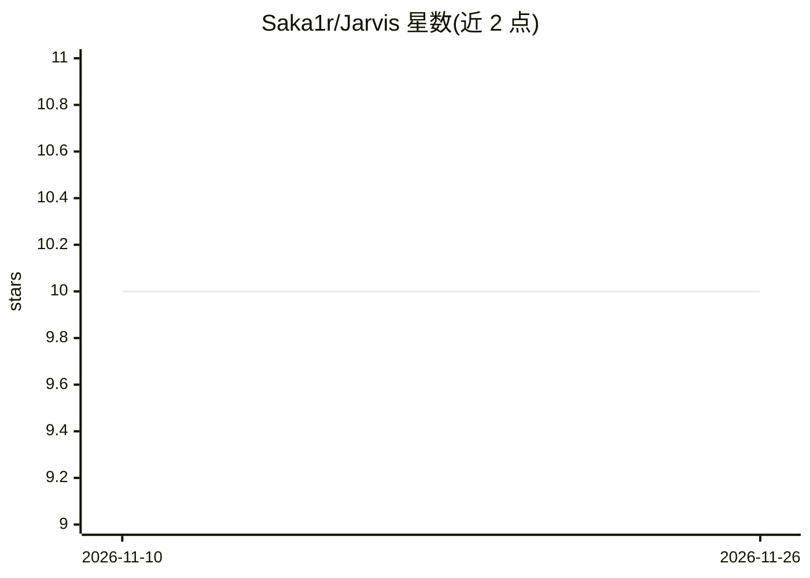

# Saka1r/Jarvis

⭐ 10 · Python · MIT · 推送 2026-11-07 · [GitHub](https://github.com/Saka1r/Jarvis) · 个人维护

**本地离线语音助手：Vosk 听写+XTTS 语音+本地 LLM 对话**

以钢铁侠 J.A.R.V.I.S. 为原型的本地语音助手，采用完全离线的开源技术栈：Vosk 负责语音识别（支持语法命令与自由对话两种模式）、Coqui XTTS v2 语音合成并支持参考音频克隆音色、llama.cpp 运行 Meta-Llama-3.1-8B-Instruct-Q6_K 生成对话。核心基于 asyncio 的有限状态机（COMMAND/FREE/SPEAKING/WAIT），带回声抑制机制；命令通过 plugins/*/commands.json 的插件系统扩展，支持 .zip 安装。无云服务、无 API key。要求 Python 3.12+、麦克风/音频输出，LLM 需约 8 GB 显存（或 CPU 慢速运行）。

## 筛选速览

| 维度 | 判定 | 备注 |
|---|---|---|
| AI 角色 | `ai-native` | 本体是模型或模型工具 |
| 许可风险 | `permissive` | MIT |
| 部署形态 | `library` | 以包/库形式分发 |
| 模型依赖 | — | README 未给出锁定关系 |
| 硬件要求 | `gpu-8g` | |
| 安装摩擦 | `medium` | 含编译或系统依赖之一 |
| 成熟度 | — | 结构信号不足 |

## 能力要点

- Vosk 语音识别支持语法命令与自由对话两种模式
- XTTS v2 语音合成可按参考音频克隆音色
- 本地 llama.cpp 运行 Llama-3.1-8B 对话，全程离线无 API key
- 插件系统与四态有限状态机、回声抑制

## 适用场景

- 搭建本地私有语音助手，替代云端方案
- 离线环境下用语音命令控制电脑
- 通过参考音频定制助手音色

## 场景标签

`语音 Agent` · 领域:对话与助手

## 证据(README 行号)

> L7: **J.A.R.V.I.S.** (*Just A Rather Very Intelligent System*) — моя интерпретация голосового ассистента Тони Старка. Ло
> L107: - 🧠 **Local LLM** (Meta-Llama-3.1-8B-Instruct-Q6_K) for conversations

## 星数曲线

2026-11-10 10 → 2026-11-26 10（+0）

---
*卡片 v1 · prompt 1.4 · 生成 2026-11-20 · 置信度 high · 依据 README sha `f22e21d32732` · [字段定义](../../DATASET.md)*
