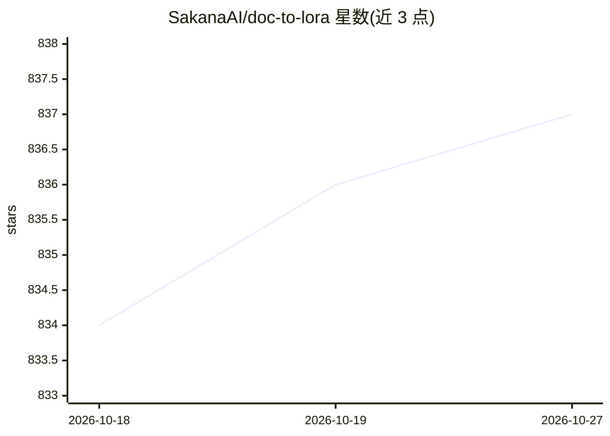

# SakanaAI/doc-to-lora

⭐ 837 · Python · MIT · 推送 2026-06-15 · [GitHub](https://github.com/SakanaAI/doc-to-lora) · [官网](https://arxiv.org/abs/2602.15902) · 组织维护

**从文档即时生成 LoRA 使 LLM 内化事实记忆的超网络参考实现**

SakanaAI 的 Doc-to-LoRA (D2L) 参考实现：训练一个超网络，读取上下文/文档并生成 LoRA 权重，使 LLM 即时内化其中的事实信息。提供 Python API（当前仅支持非批量输入）、交互式 Web 演示、自生成数据查看器，以及主实验与 NIAH（大海捞针）实验的训练/评测脚本。预训练模型通过 Hugging Face Hub 下载，安装使用 uv 工具链。面向复现论文与开展 LLM 记忆研究的研究者。

## 筛选速览

| 维度 | 判定 | 备注 |
|---|---|---|
| AI 角色 | `ai-native` | 本体是模型或模型工具 |
| 许可风险 | `permissive` | MIT |
| 部署形态 | `None` |  |
| 模型依赖 | — | README 未给出锁定关系 |
| 硬件要求 | — | 无带数字的原话,不猜 |
| 安装摩擦 | `low` | 无编译、无系统依赖或容器化 |
| 成熟度 | — | 结构信号不足 |

## 能力要点

- 超网络从上下文生成 LoRA 权重，将文档事实注入 LLM
- 提供预训练模型下载（Hugging Face Hub）
- 交互式 Web 演示与自生成数据查看器
- 包含主实验与 NIAH 实验的完整训练/评测脚本

## 适用场景

- 复现论文中的记忆内化实验与 NIAH 评测
- 研究基于超网络的 LLM 知识注入方法
- 通过交互式演示直观体验文档到 LoRA 的生成过程

## 场景标签

`模型训练` `模型评测` `科研工具` · 领域:评测与运维

## 证据(README 行号)

> L1: Doc-to-LoRA (D2L): Learning to Instantly Internalize Contexts
> L7:  A reference implementation of Doc-to-LoRA (D2L).

## 星数曲线

2026-10-18 834 → 2026-10-27 837（+3）

---
*卡片 v1 · prompt 1.4 · 生成 2026-10-21 · 置信度 high · 依据 README sha `b5ce0eed83df` · [字段定义](../../DATASET.md)*
