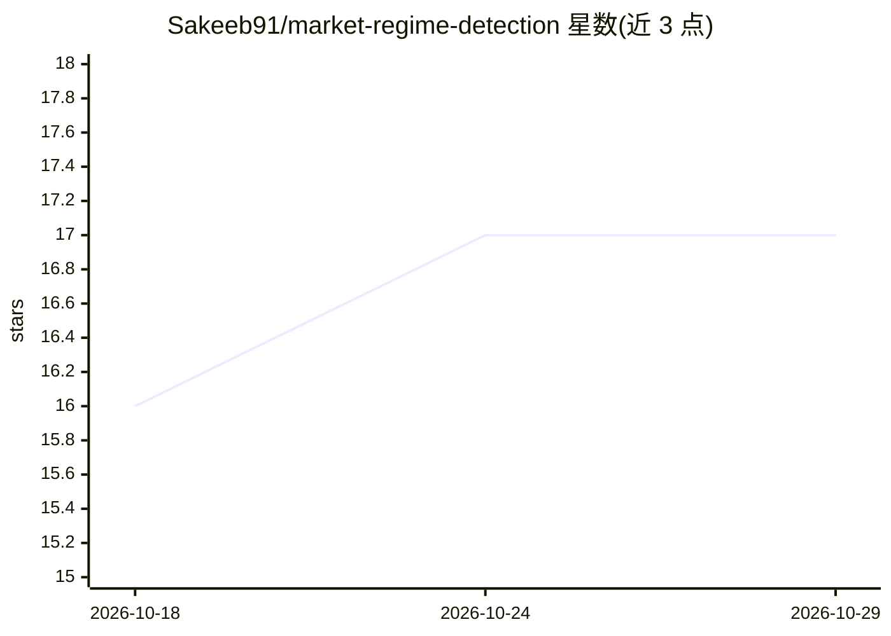

# Sakeeb91/market-regime-detection

⭐ 17 · 推送 2025-12-31 · [GitHub](https://github.com/Sakeeb91/market-regime-detection) · 个人维护

**用隐马尔可夫模型识别市场状态（牛/熊/高波动）的量化系统**

基于 Hidden Markov Models（Gaussian 发射）与机器学习的金融市场状态检测系统：从 Yahoo Finance 读取市场数据，无监督识别 bull/bear/transition 三类状态，辅以 Gaussian Mixture Models 与变点检测；提供基于状态的条件化交易策略与防前视偏差的 Walk-Forward 回测。面向量化交易与资产管理场景。README 声明仅供教育用途，预期结果以 2008、2020 危机识别为目标指标。

## 筛选速览

| 维度 | 判定 | 备注 |
|---|---|---|
| AI 角色 | `ai-native` | 本体是模型或模型工具 |
| 许可风险 | `none` | — |
| 部署形态 | `None` |  |
| 模型依赖 | — | README 未给出锁定关系 |
| 硬件要求 | — | 无带数字的原话,不猜 |
| 安装摩擦 | `low` | 无编译、无系统依赖或容器化 |
| 成熟度 | — | 结构信号不足 |

## 能力要点

- HMM 无监督状态检测（Gaussian 发射）
- GMM 备选聚类与变点检测识别结构性断裂
- 状态条件化交易策略与 Walk-Forward 回测
- 以识别 2008/2020 危机为目标指标

## 适用场景

- 为量化交易系统提供市场状态信号
- 按状态切换投资组合配置或风控策略
- 回测状态感知交易策略的表现

## 场景标签

`金融量化` · 领域:学习与行业

## 证据(README 行号)

> L3: A regime detection system using Hidden Markov Models and machine learning to identify market states (bull, bear, hig
> L20: - **Hidden Markov Models (HMM)**: Unsupervised regime detection with Gaussian emissions

## 星数曲线

2026-10-18 16 → 2026-10-29 17（+1）

---
*卡片 v1 · prompt 1.4 · 生成 2026-10-29 · 置信度 high · 依据 README sha `5f56ee84c2dd` · [字段定义](../../DATASET.md)*
