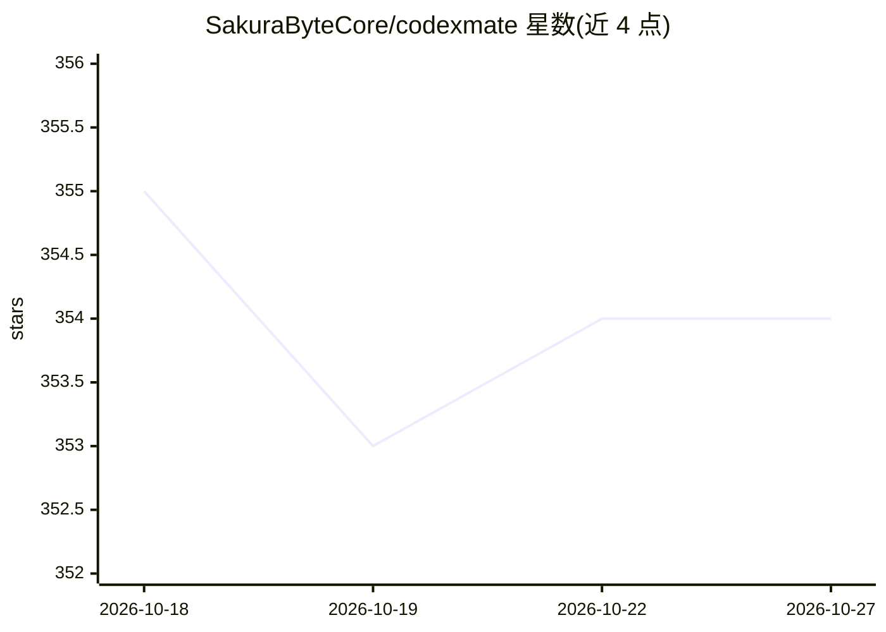

# SakuraByteCore/codexmate

⭐ 354 · JavaScript · Apache-2.0 · 推送 2026-10-26 · [GitHub](https://github.com/SakuraByteCore/codexmate) · [官网](https://sakurabytecore.github.io/codexmate/) · 组织维护 · 中文 README

**本地 AI 编程 agent 的统一控制面板：切换 provider、管理会话与任务编排**

面向同时使用多个本地 AI 编程 agent（Codex、Claude Code、Gemini CLI、CodeBuddy Code、Pi、OpenCode、KiloCode、OpenClaw）的开发者，提供本地优先的 CLI + Web UI 控制面板：统一会话浏览与导出、provider/模型切换、OpenAI 兼容桥接（将 Codex Responses API 转为标准格式并补齐指纹头）、Claude 兼容代理（可接 Ollama 与 OpenAI 兼容 provider）、KiloCode/Pi/OpenCode 配置桥、技能市场、DAG 任务队列与 MCP stdio 集成。配置与会话存于用户主目录，无云账号与遥测。项目自述处于早期阶段。

## 筛选速览

| 维度 | 判定 | 备注 |
|---|---|---|
| AI 角色 | `ai-ecosystem` | LLM/agent 周边工具 |
| 许可风险 | `permissive` | Apache-2.0 |
| 部署形态 | `library` | 以包/库形式分发 |
| 模型依赖 | local-ok | 支持本地模型 |
| 硬件要求 | — | 无带数字的原话,不猜 |
| 安装摩擦 | `low` | 无编译、无系统依赖或容器化 |
| 成熟度 | `idea` | |

## 能力要点

- 跨 Codex/Claude Code/Gemini CLI/CodeBuddy/Pi 的统一会话浏览、搜索与导出
- OpenAI 兼容桥：Codex Responses API 归一化并补齐 Codex 指纹头
- Claude Provider Bridge：经本地代理将 Claude Code 接到 OpenAI 兼容 provider 与 Ollama
- 技能市场、DAG 任务队列、MCP stdio 集成与用量分析

## 适用场景

- 我同时用多个 AI 编程 agent，想在一处切换 provider 和浏览会话
- 把 Claude Code 接到 OpenAI 兼容服务或本地 Ollama
- 跨 agent 应用导入导出技能，统一编辑 CLAUDE.md/AGENTS.md 提示词

## 场景标签

`模型网关` · 领域:Agent 开发

## 证据(README 行号)

> L5: **One dashboard for all your local AI coding agents. Switch providers, manage sessions, and orchestrate tasks across
> L33: **Codex Mate** offers a unified control plane to bring order to the chaos. It's a local-first CLI + Web UI designed
> L37: Unlike simple wrappers, Codex Mate acts as a **Local Agent Bridge**:

## 星数曲线

2026-10-18 355 → 2026-10-27 354（-1）

---
*卡片 v1 · prompt 1.4 · 生成 2026-10-21 · 置信度 high · 依据 README sha `93c29b0d9f65` · [字段定义](../../DATASET.md)*
