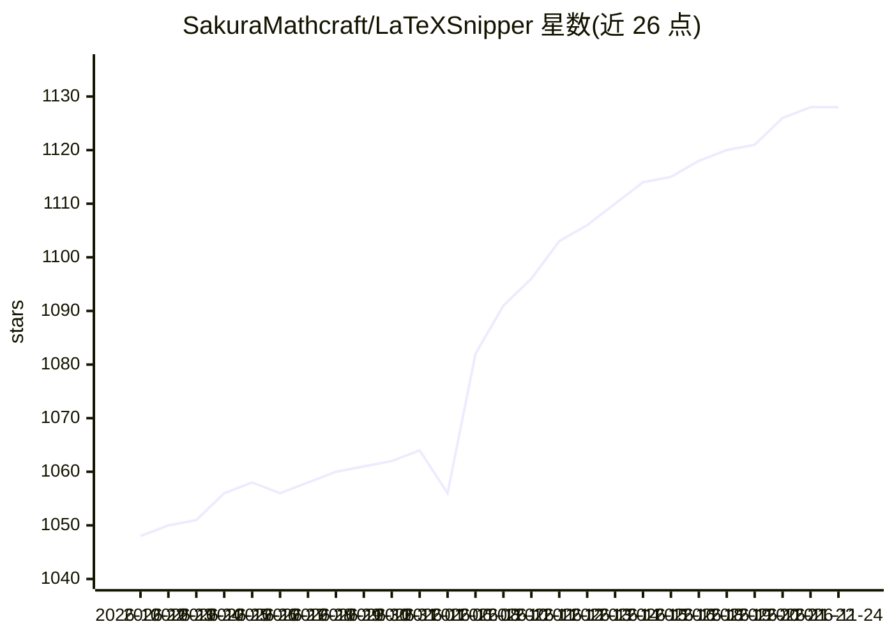

# SakuraMathcraft/LaTeXSnipper

⭐ 1,128 · Python · GPL-3.0 · 推送 2026-11-21 · [GitHub](https://github.com/SakuraMathcraft/LaTeXSnipper) · [官网](https://latexsnipper.interknot.dpdns.org/) · 个人维护 · 中文 README

**面向写作用户的截图/手写/PDF 公式识别桌面工具**

LaTeXSnipper 是一款桌面应用：截屏选区、图片、PDF 页面或手写内容可识别为公式与文本，内置 MathJax 实时预览并编辑 LaTeX 源码，支持 LaTeX、MathML、Word、PDF、Typst 等 20 种导出格式。识别默认使用捆绑的 MathCraft OCR 本地模型，也可配置外部本地/在线模型；提供 Automation API 供脚本、批量任务与编辑器集成（默认关闭，token 鉴权）。另提供 Word/PowerPoint 插件，支持公式编号与交叉引用。Windows/Linux 安装包分 CPU 与 NVIDIA GPU 版。

## 筛选速览

| 维度 | 判定 | 备注 |
|---|---|---|
| AI 角色 | `ai-native` | 本体是模型或模型工具 |
| 许可风险 | `viral` | GPL-3.0 |
| 部署形态 | `desktop` | 安装包/桌面程序 |
| 模型依赖 | — | README 未给出锁定关系 |
| 硬件要求 | — | 无带数字的原话,不猜 |
| 安装摩擦 | `medium` | 含编译或系统依赖之一 |
| 成熟度 | — | 结构信号不足 |

## 能力要点

- 截屏/图片/PDF/手写识别为公式、文本与混合内容
- 20 种导出格式（LaTeX、MathML、Word、PDF、Typst 等）
- 本地捆绑 MathCraft OCR，可配置外部模型
- Automation API 与 Office 插件集成

## 适用场景

- 把论文截图或手写公式转成可编辑 LaTeX
- 将 PDF 页面批量转为 Markdown/Word 文档
- 在 Word/PowerPoint 中插入并编号公式

## 场景标签

`OCR` `文档解析` · 领域:知识与检索

## 证据(README 行号)

> L21: |📸 **Recognize**|Capture a region, open an image, select PDF pages, or write by hand; recognize formulas, text, and
> L25: |🧠 **Choose your model**|Run the bundled MathCraft OCR locally, or configure a local/online external model|

## 星数曲线

2026-10-22 1,048 → 2026-11-24 1,128（+80）

---
*卡片 v1 · prompt 1.4 · 生成 2026-11-24 · 置信度 high · 依据 README sha `5494a63b9a1e` · [字段定义](../../DATASET.md)*
