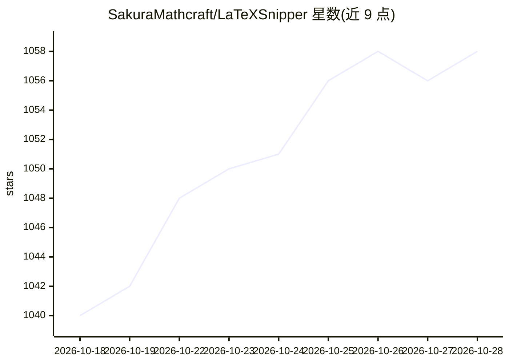

# SakuraMathcraft/LaTeXSnipper

⭐ 1,060 · Python · GPL-3.0 · 推送 2026-10-27 · [GitHub](https://github.com/SakuraMathcraft/LaTeXSnipper) · [官网](https://latexsnipper.interknot.dpdns.org/) · 个人维护 · 中文 README

**桌面公式识别与编辑工具：截图/PDF/手写转 LaTeX**

面向个人用户的桌面应用：截屏、图片、PDF 页面或手写输入经 MathCraft OCR（本地内置，也可配置外部模型）识别为 LaTeX/文本，内置 MathJax 实时预览编辑，可导出 LaTeX、MathML、Word OMML、SVG 等 20 种格式。提供 Windows/Linux 安装包（CPU 与 NVIDIA GPU 版）及 macOS Apple Silicon CPU 版；另有 Windows Office 插件在 Word/PowerPoint 中插入编辑公式，以及默认关闭的 Automation API 供脚本、批量任务与移动端经加密通道调用。PDF 导出需外部 LaTeX 引擎。

## 筛选速览

| 维度 | 判定 | 备注 |
|---|---|---|
| AI 角色 | `ai-native` | 本体是模型或模型工具 |
| 许可风险 | `viral` | GPL-3.0 |
| 部署形态 | `desktop` | 安装包/桌面程序 |
| 模型依赖 | — | README 未给出锁定关系 |
| 硬件要求 | — | 无带数字的原话,不猜 |
| 安装摩擦 | `medium` | 含编译或系统依赖之一 |
| 成熟度 | — | 结构信号不足 |

## 能力要点

- 截屏/图片/PDF/手写多来源公式识别，内置本地 MathCraft OCR
- LaTeX 编辑实时预览与 20 种导出格式（LaTeX/MathML/Word/PDF/Typst）
- Windows Word/PowerPoint 公式插件（OMML/OLE 插入）
- Automation API 支持脚本、批处理与移动端远程调用（默认关闭，需 token/HTTPS）

## 适用场景

- 把论文截图或 PDF 中的公式转成可编辑的 LaTeX
- 在 Word/PowerPoint 中直接插入和更新公式
- 通过 API 把图片批量识别为 LaTeX 并接入自己的工具

## 场景标签

`OCR` · 领域:感知与多模态

## 证据(README 行号)

> L21: |📸 **Recognize**|Capture a region, open an image, select PDF pages, or write by hand; recognize formulas, text, and
> L25: |🧠 **Choose your model**|Run the bundled MathCraft OCR locally, or configure a local/online external model|

## 星数曲线

2026-10-18 1,040 → 2026-10-28 1,058（+18）

---
*卡片 v1 · prompt 1.4 · 生成 2026-10-21 · 置信度 high · 依据 README sha `f58a544a83b9` · [字段定义](../../DATASET.md)*
