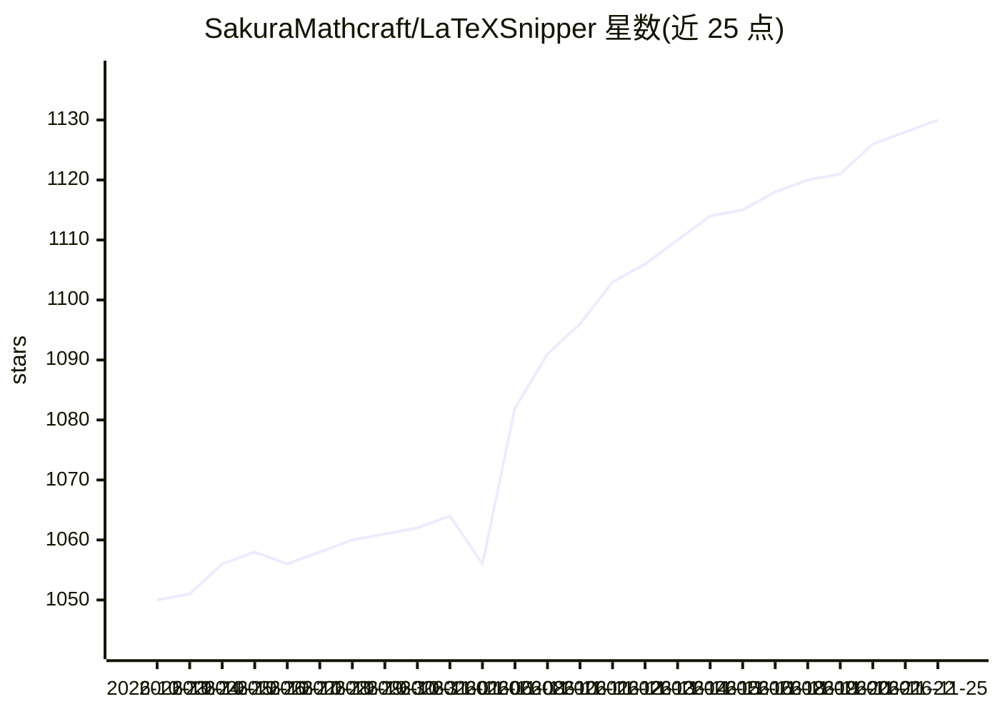

# SakuraMathcraft/LaTeXSnipper

⭐ 1,130 · Python · GPL-3.0 · 推送 2026-11-23 · [GitHub](https://github.com/SakuraMathcraft/LaTeXSnipper) · [官网](https://latexsnipper.interknot.dpdns.org/) · 个人维护 · 中文 README

**面向科研写作者的截图/手写/PDF 公式识别桌面工具**

桌面端公式与文本识别工具：支持截图区域、图片、PDF 页面与手写输入，输出可编辑的 LaTeX/文本，带公式编辑器、MathJax 实时预览与识别历史。内置 MathCraft OCR 模型本地运行，也可配置本地/在线外部模型；结果可导出 LaTeX、MathML、Word 等 20 种格式。提供 Windows/macOS/Linux 安装包、Office 插件（Word 公式编号、PowerPoint 渲染）与默认关闭的 Automation API（token 认证，远程访问需 HTTPS 并显式开启）。文档导出依赖外部 Pandoc，PDF 导出另需 LaTeX 引擎。

## 筛选速览

| 维度 | 判定 | 备注 |
|---|---|---|
| AI 角色 | `ai-native` | 本体是模型或模型工具 |
| 许可风险 | `viral` | GPL-3.0 |
| 部署形态 | `desktop` | 安装包/桌面程序 |
| 模型依赖 | — | README 未给出锁定关系 |
| 硬件要求 | — | 无带数字的原话,不猜 |
| 安装摩擦 | `medium` | 含编译或系统依赖之一 |
| 成熟度 | — | 结构信号不足 |

## 能力要点

- 截图/图片/PDF/手写四种识别入口，输出可编辑公式与文本
- 内置 MathCraft v2 权重（CPU INT8 / NVIDIA CUDA FP16），安装包自带依赖无需首run下载
- 导出 20 种格式（LaTeX、MathML、Word、PDF、Typst 等）
- Word/PowerPoint 插件与 Automation API 集成（默认禁用、token 保护）

## 适用场景

- 把论文截图里的公式转成可编辑 LaTeX
- 将手写公式数字化并复制进文档
- 从 PDF 批量提取公式和文本导出为 Markdown/Word
- 在 Word/PPT 里直接编辑识别出的公式

## 场景标签

`OCR` `科研工具` `文档解析` · 领域:知识与检索

## 证据(README 行号)

> L3: **Turn screenshots, images, PDFs, and handwriting into editable formulas and text.**
> L21: |📸 **Recognize**|Capture a region, open an image, select PDF pages, or write by hand; recognize formulas, text, and
> L25: |🧠 **Choose your model**|Run the bundled MathCraft OCR locally, or configure a local/online external model|

## 星数曲线

2026-10-23 1,050 → 2026-11-25 1,130（+80）

---
*卡片 v1 · prompt 1.4 · 生成 2026-11-25 · 置信度 high · 依据 README sha `3412957cb28a` · [字段定义](../../DATASET.md)*
