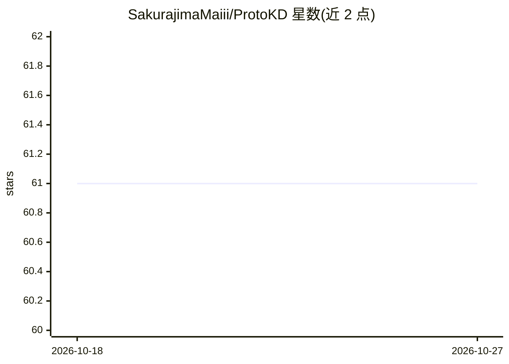

# SakurajimaMaiii/ProtoKD

⭐ 61 · Python · MIT · 推送 2026-02-21 · [GitHub](https://github.com/SakurajimaMaiii/ProtoKD) · [官网](https://arxiv.org/abs/2303.09830) · 组织维护

**ICASSP 2023 论文 ProtoKD 官方实现：模态缺失下的医学图像分割**

论文《Prototype Knowledge Distillation for Medical Segmentation with Missing Modality》的 PyTorch 官方实现，面向医学影像分割研究者。机制为两阶段训练：先训练多模态教师模型，再通过原型知识蒸馏训练单模态学生模型（T1/T2/T1ce/FLAIR 四种模态）。依赖 Python 3.8 与 PyTorch 1.12，需自行下载 BraTS2018 数据集并预处理，提供预训练模型下载（Google Drive），评估支持输出 nii.gz 可视化结果。另附缺失模态医学图像分析论文清单（有公开代码的已标注）。限制：仅提供 T1 模态的预训练模型。

## 筛选速览

| 维度 | 判定 | 备注 |
|---|---|---|
| AI 角色 | `ai-native` | 本体是模型或模型工具 |
| 许可风险 | `permissive` | MIT |
| 部署形态 | `None` |  |
| 模型依赖 | — | README 未给出锁定关系 |
| 硬件要求 | — | 无带数字的原话,不猜 |
| 安装摩擦 | `low` | 无编译、无系统依赖或容器化 |
| 成熟度 | — | 结构信号不足 |

## 能力要点

- 原型知识蒸馏：多模态教师到单模态学生的两阶段训练
- 支持 T1/T2/T1ce/FLAIR 四种模态的单模态训练与测试
- 提供教师模型与部分预训练模型（Google Drive）
- 附缺失模态医学图像分析论文合集并标注有代码的条目

## 适用场景

- 复现 ICASSP 2023 ProtoKD 论文实验结果
- 在模态缺失场景下做脑肿瘤（BraTS）分割研究
- 查找缺失模态医学图像分割方向的论文与开源代码

## 场景标签

`多模态` `目标检测` `精选清单` · 领域:学习与行业

## 证据(README 行号)

> L3: 1. PyTorch official implementation of __Prototype Knowledge Distillation for Medical Segmentation with Missing Modal
> L45: python train_protokd.py --modality 0 --log_dir ../log/protokd_modality0

## 星数曲线

2026-10-18 61 → 2026-10-27 61（+0）

---
*卡片 v1 · prompt 1.4 · 生成 2026-10-24 · 置信度 high · 依据 README sha `2dcb3a5ab072` · [字段定义](../../DATASET.md)*
