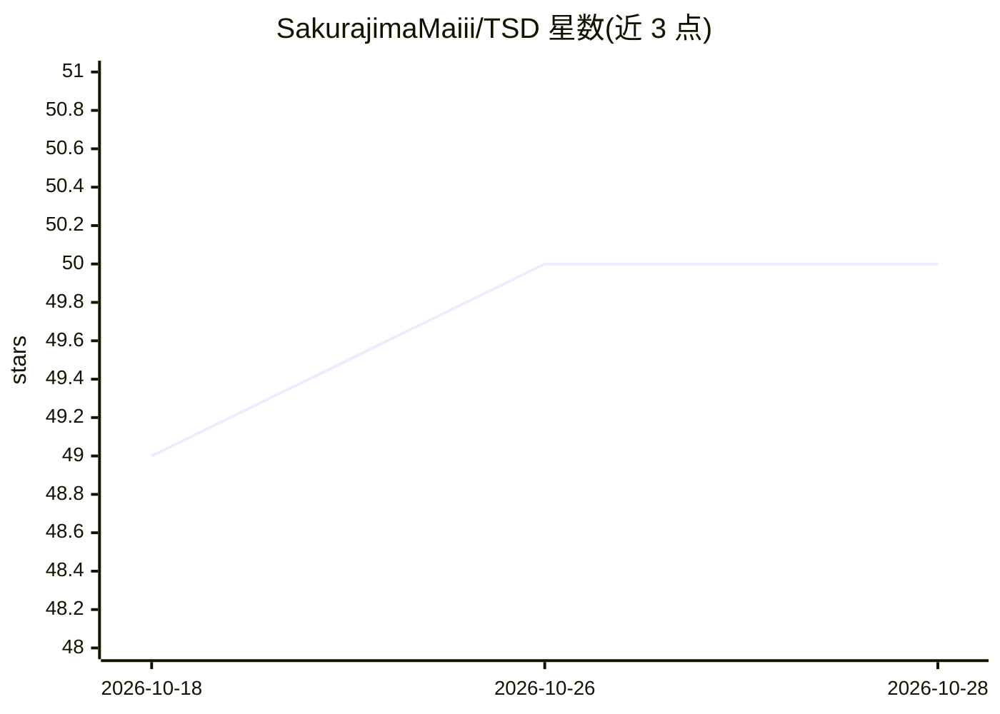

# SakurajimaMaiii/TSD

⭐ 50 · Python · MIT · 推送 2025-11-23 · [GitHub](https://github.com/SakurajimaMaiii/TSD) · [官网](https://arxiv.org/abs/2303.10902) · 个人维护

**CVPR 2023 测试时自适应方法 TSD 的官方 PyTorch 实现**

论文 Feature Alignment and Uniformity for Test Time Adaptation（CVPR 2023）的官方 PyTorch 代码库，实现 TSD 测试时自适应算法，并内置 T3A、SHOT-IM、Tent 等其他自适应方法供调用。基于 T3A 与 DeepDG 构建，面向域泛化研究者：先在 PACS/OfficeHome/VLCS/DomainNet 等数据集上训练源模型（支持 ResNeXt50、ViT-B16 等骨干），再用 unsupervise_adapt.py 做无监督测试时自适应。需 Python 3.8 与 torch 1.12 环境，数据集需自行下载组织。

## 筛选速览

| 维度 | 判定 | 备注 |
|---|---|---|
| AI 角色 | `ai-native` | 本体是模型或模型工具 |
| 许可风险 | `permissive` | MIT |
| 部署形态 | `None` |  |
| 模型依赖 | — | README 未给出锁定关系 |
| 硬件要求 | — | 无带数字的原话,不猜 |
| 安装摩擦 | `low` | 无编译、无系统依赖或容器化 |
| 成熟度 | — | 结构信号不足 |

## 能力要点

- TSD 测试时自适应算法的官方实现
- 可切换 T3A/SHOT-IM/Tent 等多种自适应方法对比
- 支持 PACS/OfficeHome/VLCS/DomainNet 四类域泛化数据集
- 支持 resnext50、ViT-B16 等多种骨干网络

## 适用场景

- 复现 CVPR 2023 TSD 论文实验结果
- 在域泛化数据集上做测试时自适应研究
- 对比不同测试时自适应方法的性能

## 场景标签

 · 领域:计算机视觉/机器学习

## 证据(README 行号)

> L2: __This repo is officical PyTorch implement of Feature Alignment and Uniformity for Test Time Adaptation (CVPR 2023) 
> L40: python unsupervise_adapt.py --dataset PACS \

## 星数曲线

2026-10-18 49 → 2026-10-28 50（+1）

---
*卡片 v1 · prompt 1.4 · 生成 2026-10-24 · 置信度 high · 依据 README sha `ef08a0b64e39` · [字段定义](../../DATASET.md)*
