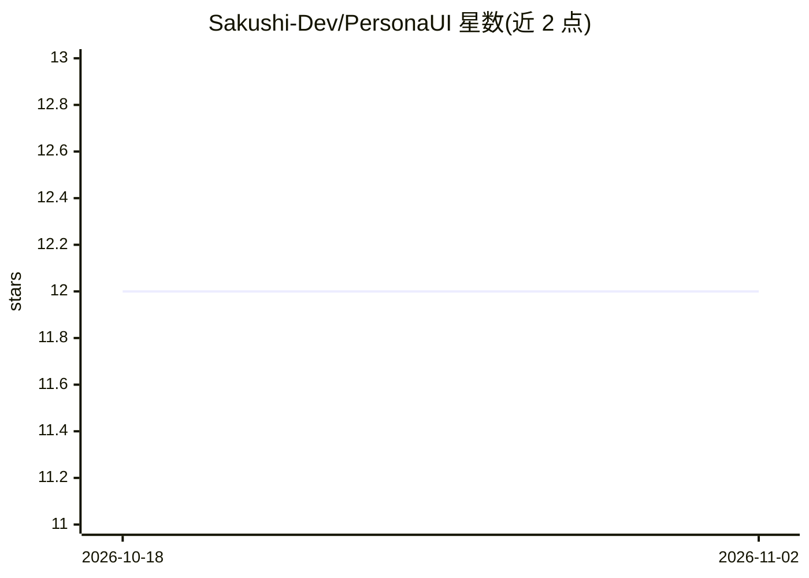

# Sakushi-Dev/PersonaUI

⭐ 12 · Python · AGPL-3.0 · 推送 2026-04-05 · [GitHub](https://github.com/Sakushi-Dev/PersonaUI) · [官网](https://sakushi-dev.github.io/PersonaUI-Page/) · 个人维护

**本地桌面应用：创建有人格、情感与持久记忆的 AI 伙伴**

基于 PyWebView + React 19 的本地桌面应用，用户可创建具有性格、情绪与设定的 AI 角色（Persona），通过 Anthropic Claude API 生成对话。核心机制是 Cortex 三文件记忆系统（Memory/Soul/Relationship），由 AI 自主经 tool use 更新；支持 Afterthought 主动追问、36 个提示模板、斜杠命令与局域网共享（IP 白名单/二维码）。所有数据存储在本机 SQLite，除 API 请求外不上传云端。Windows 提供一键启动脚本，Linux/macOS 需手动搭建。

## 筛选速览

| 维度 | 判定 | 备注 |
|---|---|---|
| AI 角色 | `ai-native` | 本体是模型或模型工具 |
| 许可风险 | `viral` | AGPL-3.0 |
| 部署形态 | `desktop` | 安装包/桌面程序 |
| 模型依赖 | locked-api |  |
| 硬件要求 | — | 无带数字的原话,不猜 |
| 安装摩擦 | `low` | 无编译、无系统依赖或容器化 |
| 成熟度 | — | 结构信号不足 |

## 能力要点

- Cortex 三文件记忆系统（Memory/Soul/Relationship），按上下文阈值自主更新
- Afterthought 系统：AI 可主动发送可取消的追问消息（10 秒计时）
- 每人格独立 SQLite 数据库，数据全部本地存储
- 局域网共享：IP 访问控制、二维码移动端接入

## 适用场景

- 创建并长期陪伴一个记得住过往对话的 AI 角色
- 自定义角色性格、知识领域与对话场景
- 在本机私有化保存全部对话与记忆数据

## 场景标签

`聊天机器人` · 领域:对话与助手

## 证据(README 行号)

> L6:  A desktop application for creating AI companions with distinct personalities, emotional depth, and persistent memor
> L19: The application runs as a native desktop window (via PyWebView) with a modern React frontend. It connects to Anthro

## 星数曲线

2026-10-18 12 → 2026-11-02 12（+0）

---
*卡片 v1 · prompt 1.4 · 生成 2026-11-01 · 置信度 mid · 依据 README sha `d51bacc64c6a` · [字段定义](../../DATASET.md)*
