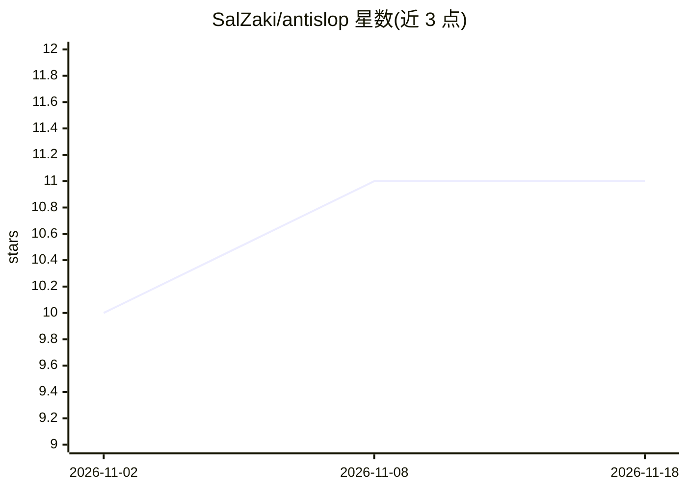

# SalZaki/antislop

⭐ 11 · Python · MIT · 推送 2026-06-27 · [GitHub](https://github.com/SalZaki/antislop) · 个人维护

**Claude Code 插件：检测并去除文本中的 AI 痕迹**

以 Claude Code 插件形式分发的一组技能（skills），共享同一检测引擎，提供三种视角：改写文本去除 AI 痕迹、按类别和严重度定位 AI 痕迹、输出逐类别质量 breakdown。检测分两层：确定性层由零依赖 Python 脚本统计可数痕迹（词表命中、破折号密度、模板等），判定层由 Claude 模型处理依赖语义的痕迹。支持用户自定义词表与豁免清单，CI 中含仅报告模式的 slop 检查。

## 筛选速览

| 维度 | 判定 | 备注 |
|---|---|---|
| AI 角色 | `ai-native` | 本体是模型或模型工具 |
| 许可风险 | `permissive` | MIT |
| 部署形态 | `None` |  |
| 模型依赖 | locked-api |  |
| 硬件要求 | — | 无带数字的原话,不猜 |
| 安装摩擦 | `low` | 无编译、无系统依赖或容器化 |
| 成熟度 | — | 结构信号不足 |

## 能力要点

- 三个技能共享同一检测引擎（shared/spec.md + slop_count.py）
- 确定性层为零依赖 Python 3 脚本，同输入同输出
- 支持个人级与项目级自定义词表/豁免清单，无需 fork
- 渐进式加载 SKILL.md，词表与修复方案按需载入

## 适用场景

- 发布前检查文章中的 AI 写作痕迹
- 改写文本使其更接近本人语气同时保留原意
- 在团队仓库中共享项目级写作规范豁免清单

## 场景标签

`AI 写作` · 领域:内容生成

## 证据(README 行号)

> L3: A Claude Code plugin for keeping writing free of AI-generated tells. Three lenses over one detection engine: rewrite
> L21: - **Deterministic tier.** `shared/slop_count.py` is a zero-dependency Python 3 script that counts the *countable* t
> L22: - **Judged tier.** The Claude model handles the meaning-dependent tells (promotional padding, copula avoidance, reg

## 星数曲线

2026-11-02 10 → 2026-11-18 11（+1）

---
*卡片 v1 · prompt 1.4 · 生成 2026-11-18 · 置信度 high · 依据 README sha `12c03790876d` · [字段定义](../../DATASET.md)*
