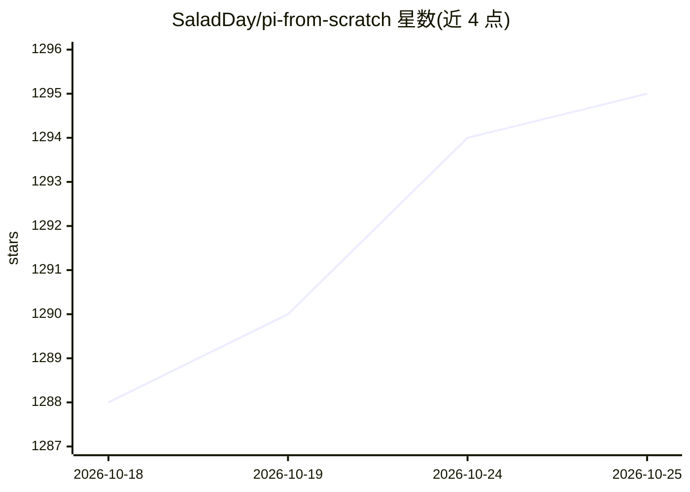

# SaladDay/pi-from-scratch

⭐ 1,295 · TypeScript · MIT · 推送 2026-10-24 · [GitHub](https://github.com/SaladDay/pi-from-scratch) · [官网](https://pi-from-scratch.vercel.app) · 个人维护 · 中文 README

**600 行 TypeScript 从零实现 coding agent 的交互式教程**

以交互式教学网站形式呈现的文章项目：沿着 pi 的数据流拆解组件，从零实现一个能读文件、改代码、执行命令的 TypeScript coding agent（nano-pi）。网站将文章与源码并排展示，阅读推进时右侧编辑器逐步补全代码，并提供预先生成的 Trace 断点调试视图。运行 nano-pi 需要 Node.js 22+ 与一个 OpenAI 兼容 API；线上 trace 为静态数据，浏览网站不发起模型请求。

## 筛选速览

| 维度 | 判定 | 备注 |
|---|---|---|
| AI 角色 | `ai-knowledge` | 知识聚合/清单类 |
| 许可风险 | `permissive` | MIT |
| 部署形态 | `library` | 以包/库形式分发 |
| 模型依赖 | — | README 未给出锁定关系 |
| 硬件要求 | — | 无带数字的原话,不猜 |
| 安装摩擦 | `low` | 无编译、无系统依赖或容器化 |
| 成熟度 | — | 结构信号不足 |

## 能力要点

- 约 600 行 TypeScript 从零实现 nano-pi coding agent
- 文章与编辑器联动，阅读时逐步补全代码
- Trace 断点视图跟踪代码执行流
- 通过 NANOPI_BASE_URL 支持 OpenAI 兼容接口

## 适用场景

- 通过跟读教程理解 pi 的核心数据流与 agent-loop 机制
- 亲手实现一个支持 tool-calling 的迷你 coding agent
- 作为 TypeScript 编写 agent 的入门学习材料

## 场景标签

`教程课程` · 领域:学习与行业

## 证据(README 行号)

> L7: 从零手写一个能读文件、改代码、执行命令的 TypeScript coding agent。
> L9: 项目沿着 pi 的数据流拆解，需要什么、我们造什么，所有组件都是符合直觉的。
> L15: 网站把文章和源码放在一起。阅读推进时，右侧编辑器会逐步补全代码，当你看完的时候，nano-pi 的代码也会全部呈现在编辑器中。

## 星数曲线

2026-10-18 1,288 → 2026-10-25 1,295（+7）

---
*卡片 v1 · prompt 1.4 · 生成 2026-10-21 · 置信度 high · 依据 README sha `02e203774aea` · [字段定义](../../DATASET.md)*
