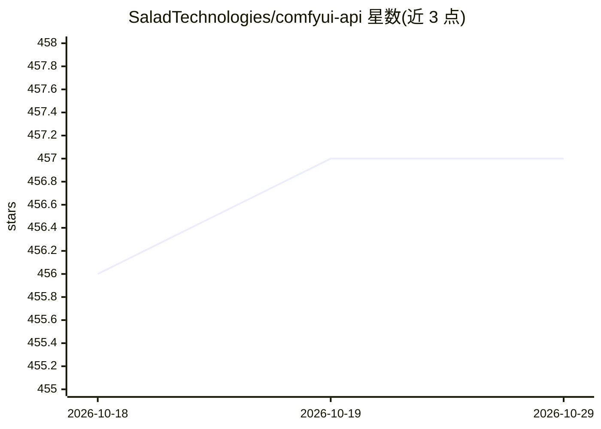

# SaladTechnologies/comfyui-api

⭐ 457 · TypeScript · MIT · 推送 2026-09-18 · [GitHub](https://github.com/SaladTechnologies/comfyui-api) · 组织维护

**把 ComfyUI 包装成无状态、可横向扩展的图像生成 API 服务器**

SaladTechnologies 维护的 ComfyUI API 封装服务器：接收 ComfyUI prompt 图，先下载所需输入，排队执行后以 base64 直接返回，或通过 webhook、S3 兼容存储、Azure Blob、Hugging Face 仓库异步交付。无状态设计支持负载均衡下横向扩容；提供启动预热工作流、manifest 自动下载模型与安装自定义节点、动态工作流端点、/health 与 /ready 探针。以单二进制或 Docker 镜像分发，默认监听 3000 端口，自带 Swagger 文档。针对 SaladCloud 平台做了实例删除成本联动等适配。

## 筛选速览

| 维度 | 判定 | 备注 |
|---|---|---|
| AI 角色 | `ai-ecosystem` | LLM/agent 周边工具 |
| 许可风险 | `permissive` | MIT |
| 部署形态 | `desktop` | 安装包/桌面程序 |
| 模型依赖 | — | README 未给出锁定关系 |
| 硬件要求 | — | 无带数字的原话,不猜 |
| 安装摩擦 | `low` | 无编译、无系统依赖或容器化 |
| 成熟度 | — | 结构信号不足 |

## 能力要点

- 无状态设计，可横向扩展，支持同步 base64 返回与 webhook 异步交付
- 输出可上传 S3 兼容存储、HTTP 端点、Hugging Face 仓库或 Azure Blob
- manifest（JSON/YAML）启动时自动装 apt/pip 包、装自定义节点、下载模型
- 单二进制分发、无依赖运行，自带 Swagger 文档与健康/就绪探针

## 适用场景

- 把 ComfyUI 工作流暴露为 HTTP API 供应用调用
- 在负载均衡后横向扩展图像/视频生成服务
- 部署到 SaladCloud 等分布式容器平台跑 Stable Diffusion、Flux 等模型

## 场景标签

`图像生成` · 领域:内容生成

## 证据(README 行号)

> L3: A simple wrapper that facilitates using ComfyUI as a stateless API, either by receiving images in the response, or b
> L30: - **Full Power Of ComfyUI**: The server supports the full ComfyUI /prompt API, and can be used to execute any Comfy
> L53: ComfyUI API sits in front of ComfyUI, and uses the ComfyUI `/prompt` API to execute workflows, so any API-formatted

## 星数曲线

2026-10-18 456 → 2026-10-29 457（+1）

---
*卡片 v1 · prompt 1.4 · 生成 2026-10-21 · 置信度 mid · 依据 README sha `9803fbe501c5` · [字段定义](../../DATASET.md)*
