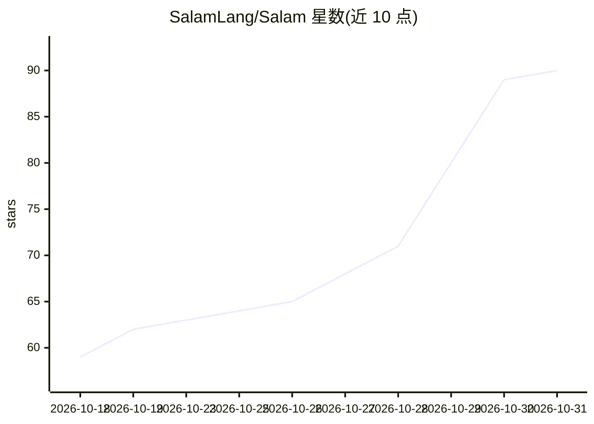

# SalamLang/Salam

⭐ 90 · TeX · GPL-3.0 · 推送 2026-10-30 · [GitHub](https://github.com/SalamLang/Salam) · [官网](https://salamlang.github.io/Salam/) · 组织维护

**面向波斯语和英语用户的通用与系统级编程语言（含内置 DSL）**

静态类型、编译型的通用编程语言：通用语言转译到 C 并构建原生可执行文件，内嵌 layout: 块编译为 HTML/CSS/JS；默认 C 后端（tcc，也可用 gcc/clang），另提供基于 LLVM 的交叉编译（--target 三元组），支持 MinGW/musl sysroot 打包。面向波斯语使用者提供母语编程体验，也面向初学者。提供 shell/PowerShell/cmd 一键安装脚本、Docker 镜像（Alpine，含 LLVM 22）与 11 个编辑器集成。限制：MSVC/macOS 交叉目标需自备工具链，LLVM 后端仅支持语言子集。

## 筛选速览

| 维度 | 判定 | 备注 |
|---|---|---|
| AI 角色 | `ai-enhanced` | 去掉 AI 部分产品仍成立 |
| 许可风险 | `viral` | GPL-3.0 |
| 部署形态 | `desktop` | 安装包/桌面程序 |
| 模型依赖 | — | README 未给出锁定关系 |
| 硬件要求 | — | 无带数字的原话,不猜 |
| 安装摩擦 | `low` | 无编译、无系统依赖或容器化 |
| 成熟度 | `idea` | |

## 能力要点

- 通用语言转译到 C 构建原生可执行文件，内置 layout: DSL 编译为 HTML/CSS/JS
- 波斯语与英语关键字完整支持，编辑器词表由编译器自身表生成
- 基于 LLVM 后端的交叉编译（Windows/MinGW、Linux/musl 目标）
- 官方安装脚本（Linux/macOS/Windows）与 Alpine Docker 开发/生产镜像

## 适用场景

- 波斯语开发者用母语编写系统级与通用程序
- 在单一语言中同时产出原生程序与 HTML/CSS/JS 页面
- 通过 Docker 环境构建编译器或交叉编译目标平台可执行文件

## 场景标签

 · 领域:编程语言/编译器

## 证据(README 行号)

> L5: Salam is a general-purpose and systems programming language designed for efficient software development, featuring a
> L137: Salam is statically typed and compiled. The **general** language transpiles to C) and is

## 星数曲线

2026-10-18 59 → 2026-10-31 90（+31）

---
*卡片 v1 · prompt 1.4 · 生成 2026-10-24 · 置信度 low · 依据 README sha `24d210e1e4a4` · [字段定义](../../DATASET.md)*
