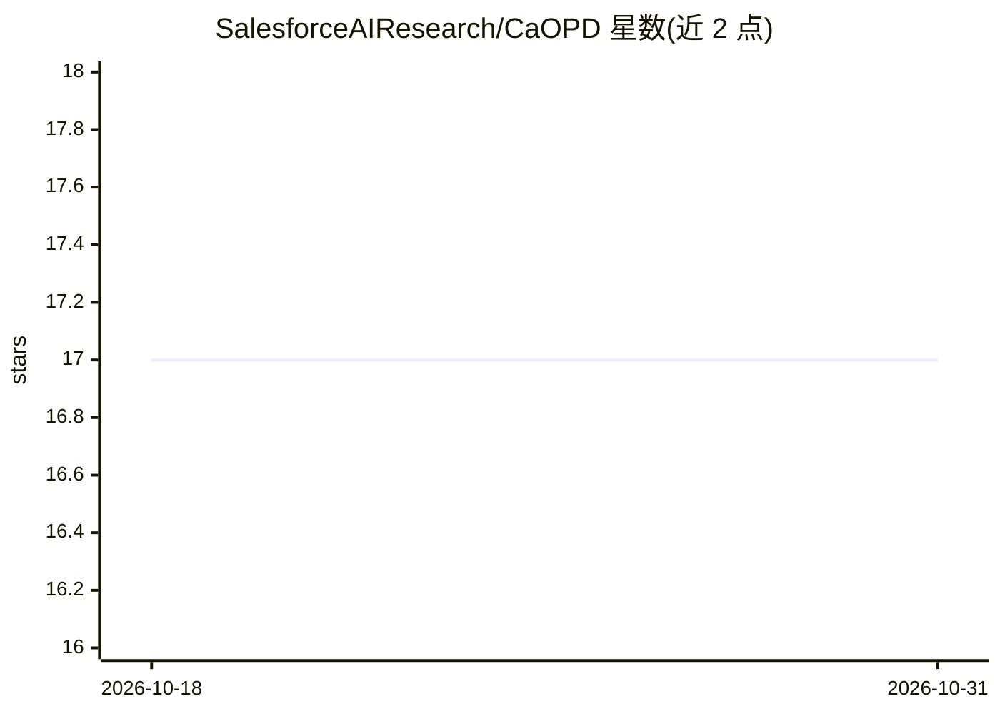

# SalesforceAIResearch/CaOPD

⭐ 17 · Python · NOASSERTION · 推送 2026-06-02 · [GitHub](https://github.com/SalesforceAIResearch/CaOPD) · 组织维护

**LLM 后训练方法代码：校准感知的在线策略蒸馏框架**

Salesforce AI Research 论文《The Illusion of Certainty》的官方代码。针对在线策略蒸馏（OPD）导致的模型过度自信问题，提出 CaOPD：从学生模型 K 次 rollout 计算经验成功率 P_acc，在学生完成、教师示例、教师备注三处替换置信度目标，再用标准 KL 自蒸馏损失训练。支持 demo 与 correct_solution 两种教师上下文模式，在 NVIDIA H200 GPU（单节点 8 卡）上测试 Qwen3-8B 等模型，提供准确率与 ECE/Brier/SPR/OCG 校准评测脚本。

## 筛选速览

| 维度 | 判定 | 备注 |
|---|---|---|
| AI 角色 | `ai-ecosystem` | LLM/agent 周边工具 |
| 许可风险 | `none` | NOASSERTION |
| 部署形态 | `library` | 以包/库形式分发 |
| 模型依赖 | — | README 未给出锁定关系 |
| 硬件要求 | — | 无带数字的原话,不猜 |
| 安装摩擦 | `low` | 无编译、无系统依赖或容器化 |
| 成熟度 | — | 结构信号不足 |

## 能力要点

- 以 rollout 经验成功率 P_acc 替换自报置信度的目标替换机制
- 支持 SDFT（demo）与 SDPO（correct_solution）两种教师上下文模式
- 提供 ECE/Brier/SPR/OCG 四种校准评测指标脚本
- 设计为可加装到任意 OPD 方法的模块化修改

## 适用场景

- 后训练 LLM 时缓解过度自信、改进置信度校准
- 复现论文中 Science Q&A 与 Tool Use 领域实验
- 研究能力与校准解耦的扩展分析（0.6B–32B 模型）

## 场景标签

`微调` · 领域:训练与推理

## 证据(README 行号)

> L9: This is the official code for the paper:
> L19: On-policy distillation (OPD) is an increasingly important paradigm for post-training language models. However, we i
> L32: **The Solution**: CaOPD adds a single, clean modification to any OPD loop — **target replacement** with the student

## 星数曲线

2026-10-18 17 → 2026-10-31 17（+0）

---
*卡片 v1 · prompt 1.4 · 生成 2026-10-29 · 置信度 mid · 依据 README sha `b14d4bbf3510` · [字段定义](../../DATASET.md)*
