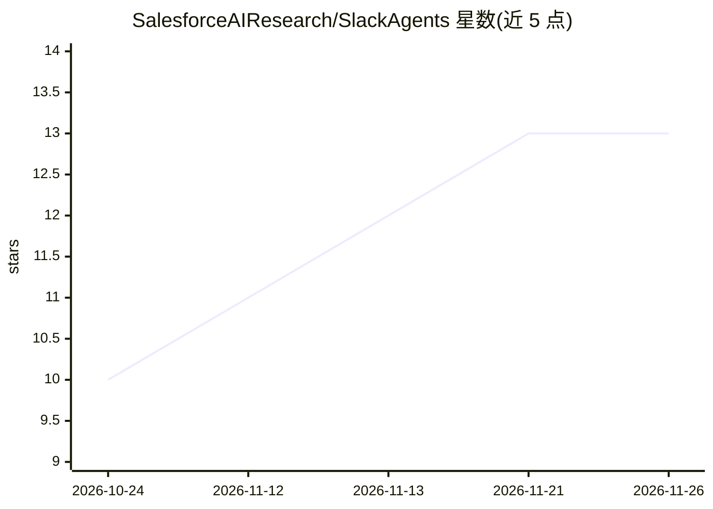

# SalesforceAIResearch/SlackAgents

⭐ 13 · Python · Apache-2.0 · 推送 2026-06-02 · [GitHub](https://github.com/SalesforceAIResearch/SlackAgents) · 组织维护

**在 Slack 工作区构建多 AI Agent 协作的 Python 库**

SlackAgents 是一个 Python 库，用于在 Slack 工作区内部署 AI Agent，支持多 Agent 协作与管理。核心组件包括 Assistant（助手基类）、WorkflowAgent（多步骤工作流执行）、FunctionTool/OpenAPITool（自定义工具封装）和 OpenAILLM 接口。通过 CLI 提供 Agent 的创建、列表、启动、停止、删除等管理命令。安装需 Python 3.12+，运行需配置 OpenAI API Key 并创建 Slack App（bot token/app token 及指定权限 scope）。

## 筛选速览

| 维度 | 判定 | 备注 |
|---|---|---|
| AI 角色 | `ai-ecosystem` | LLM/agent 周边工具 |
| 许可风险 | `permissive` | Apache-2.0 |
| 部署形态 | `library` | 以包/库形式分发 |
| 模型依赖 | — | README 未给出锁定关系 |
| 硬件要求 | — | 无带数字的原话,不猜 |
| 安装摩擦 | `low` | 无编译、无系统依赖或容器化 |
| 成熟度 | — | 结构信号不足 |

## 能力要点

- 多 Agent 协作：通过 colleagues 配置在同一频道内多个 Agent/用户交互
- WorkflowAgent 与 ExecutionGraph 定义多步骤工作流与 Agent 间任务转移
- CLI 管理 Agent 生命周期（create/list/start/stop/delete）
- FunctionTool 与 OpenAPITool 封装自定义工具与 OpenAPI 规范

## 适用场景

- 在 Slack 频道中部署可对话的助手 Agent
- 编排多 Agent 协作流程（如数据报告→日程安排→邮件通知）
- 将 Jira/日历/邮件等业务流程接入 Slack 自动化

## 场景标签

`多智能体` `Agent 框架` `工作流自动化` · 领域:Agent 开发

## 证据(README 行号)

> L15: 🤖 **SlackAgents** is a flexible library designed to facilitate the deployment of AI agents within your Slack worksp
> L283: |`Assistant`|A base class for creating AI assistants|`src/slackagents/agent/assistant.py`|
> L290: |`OpenAILLM`|An interface for OpenAI's language models|`src/slackagents/llms/openai.py`|

## 星数曲线

2026-10-24 10 → 2026-11-26 13（+3）

---
*卡片 v1 · prompt 1.4 · 生成 2026-11-18 · 置信度 high · 依据 README sha `56d1507b1dec` · [字段定义](../../DATASET.md)*
