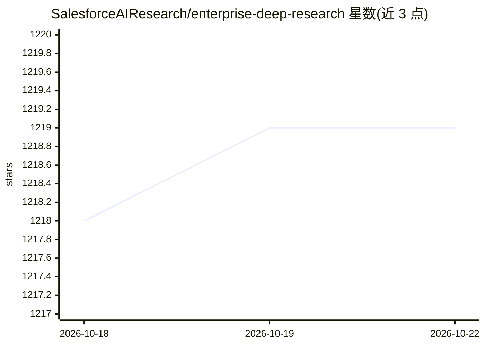

# SalesforceAIResearch/enterprise-deep-research

⭐ 1,219 · Python · Apache-2.0 · 推送 2026-06-02 · [GitHub](https://github.com/SalesforceAIResearch/enterprise-deep-research) · 组织维护

**企业级多智能体深度研究系统：自动生成研究报告**

Salesforce AI Research 推出的多智能体深度研究系统 EDR：主规划 Agent 做查询分解，四个专用搜索 Agent（通用/学术/GitHub/LinkedIn）检索，MCP 工具生态支持 NL2SQL、文件分析等企业工作流，可视化 Agent 与反思机制检测知识缺口，支持实时流式输出与人机协同转向指令。需 Python 3.11+ 与 Node.js 20.9.0+，配置 Tavily API key 及一个 LLM provider key（OpenAI/Anthropic/Groq/Google/SambaNova），可运行 Web 全栈应用或 CLI，并附带 EDR-200 轨迹数据集与多个基准评测。

## 筛选速览

| 维度 | 判定 | 备注 |
|---|---|---|
| AI 角色 | `ai-native` | 本体是模型或模型工具 |
| 许可风险 | `permissive` | Apache-2.0 |
| 部署形态 | `None` |  |
| 模型依赖 | locked-api |  |
| 硬件要求 | — | 无带数字的原话,不猜 |
| 安装摩擦 | `low` | 无编译、无系统依赖或容器化 |
| 成熟度 | — | 结构信号不足 |

## 能力要点

- 主规划 Agent + 4 个专用搜索 Agent + 可视化 Agent 的多智能体架构
- MCP 工具生态支持 NL2SQL、文件分析与企业工作流
- 反思机制检测知识缺口，支持实时转向与人机协同指令
- 发布 EDR-200 数据集（201 条完整研究轨迹）并参与多个基准评测

## 适用场景

- 企业内自动化开展深度数据分析并生成研究报告
- 在 Web 界面实时跟踪与干预多智能体研究过程
- 基于 EDR-200 轨迹数据集研究智能体规划与决策行为

## 场景标签

`多智能体` `科研工具` · 领域:Agent 开发

## 证据(README 行号)

> L33: We present **Enterprise Deep Research (EDR)**, a multi-agent system that integrate:
> L34: - Master Planning Agent for adaptive query decomposition.
> L35: - Four specialized search agents (General, Academic, GitHub, LinkedIn).

## 星数曲线

2026-10-18 1,218 → 2026-10-22 1,219（+1）

---
*卡片 v1 · prompt 1.4 · 生成 2026-10-21 · 置信度 high · 依据 README sha `789eea7759b3` · [字段定义](../../DATASET.md)*
