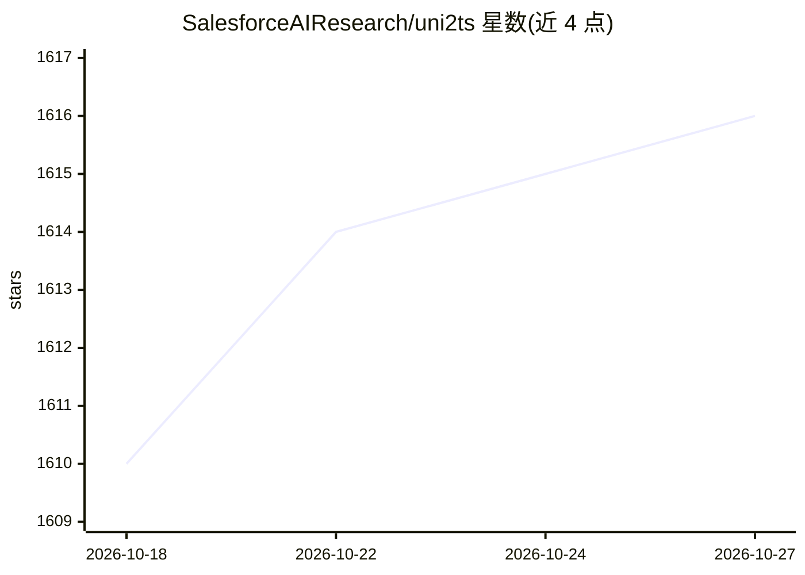

# SalesforceAIResearch/uni2ts

⭐ 1,616 · Jupyter Notebook · Apache-2.0 · 推送 2026-06-02 · [GitHub](https://github.com/SalesforceAIResearch/uni2ts) · 组织维护

**时序预测基础模型库：统一预训练、微调与评估 Moirai**

Salesforce AI Research 维护的 PyTorch 时序预测库，为通用时序 Transformer（Moirai 系列）提供大规模预训练、微调、推理与评估的统一框架。推理依赖 GluonTS，数据处理使用 Hugging Face datasets，微调与预训练通过 Hydra 配置的 CLI 脚本运行，支持零样本预测。模型权重托管在 Hugging Face，预训练数据为 LOTSA 数据集。声明本发布仅用于支持学术论文的研究目的。

## 筛选速览

| 维度 | 判定 | 备注 |
|---|---|---|
| AI 角色 | `ai-native` | 本体是模型或模型工具 |
| 许可风险 | `permissive` | Apache-2.0 |
| 部署形态 | `library` | 以包/库形式分发 |
| 模型依赖 | — | README 未给出锁定关系 |
| 硬件要求 | — | 无带数字的原话,不猜 |
| 安装摩擦 | `low` | 无编译、无系统依赖或容器化 |
| 成熟度 | — | 结构信号不足 |

## 能力要点

- 统一框架覆盖预训练、微调、推理与评估全流程
- 提供 Moirai / Moirai-MoE 系列预训练模型权重
- Hydra 配置的 CLI 脚本运行训练与评估任务
- 支持零样本预测与 pandas DataFrame 输入

## 适用场景

- 在自己的时序数据上微调 Moirai 模型
- 对时序预测模型做 MSE/CRPS 等指标评估
- 基于 LOTSA 数据集预训练自定义模型
- 使用预训练模型做零样本时序预测

## 场景标签

`微调` `模型训练` · 领域:训练与推理

## 证据(README 行号)

> L9: Uni2TS is a PyTorch based library for research and applications related to Time Series Forecasting. It provides a un
> L61: Let's see a simple example on how to use Uni2TS to make zero-shot forecasts from a pre-trained model.

## 星数曲线

2026-10-18 1,610 → 2026-10-27 1,616（+6）

---
*卡片 v1 · prompt 1.4 · 生成 2026-10-21 · 置信度 high · 依据 README sha `5e55763ff254` · [字段定义](../../DATASET.md)*
