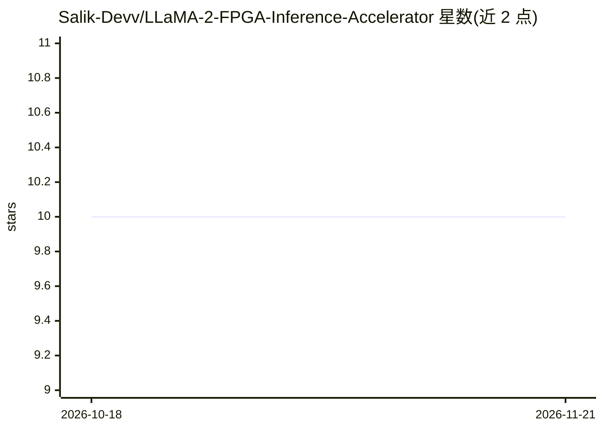

# Salik-Devv/LLaMA-2-FPGA-Inference-Accelerator

⭐ 10 · C++ · MIT · 推送 2026-07-22 · [GitHub](https://github.com/Salik-Devv/LLaMA-2-FPGA-Inference-Accelerator) · 个人维护

**面向研究者的 LLaMA-2 FPGA/CPU 混合推理引擎（ZCU102）**

将 LLaMA-2 的四种矩阵乘法形状卸载到 ZCU102 板上的 Vitis HLS 专用内核，非线性算子（RMSNorm、RoPE、attention、SwiGLU）保留在 ARM Cortex-A53 上运行，构成混合推理引擎；模型为 stories15M（llama2.c checkpoint 格式）。附 PMBus 轨级功耗测量方法（n=8 次重复、去空闲基线），给出 FPGA 路径相对纯 CPU 基线的吞吐与能效数据，并记录调试过程。构建依赖 Vitis HLS/Vivado 交叉编译流程，需自行合成 bitstream 并部署到目标板。

## 筛选速览

| 维度 | 判定 | 备注 |
|---|---|---|
| AI 角色 | `ai-native` | 本体是模型或模型工具 |
| 许可风险 | `permissive` | MIT |
| 部署形态 | `None` |  |
| 模型依赖 | — | README 未给出锁定关系 |
| 硬件要求 | — | 无带数字的原话,不猜 |
| 安装摩擦 | `high` | 编译与系统依赖俱全 |
| 成熟度 | — | 结构信号不足 |

## 能力要点

- 四种 matmul 形状卸载至专用 Vitis HLS 内核，占用 ZCU102 全部六个 HP/HPC 端口
- PMBus 轨级功耗测量方法（12 条轨、n=8、空闲扣除、|mean|>2×SE 筛选）
- 使用 Karpathy llama2.c 的 stories15M checkpoint 与 tokenizer 格式
- 附调试记录：classifier 内核拆分、DATAFLOW 规范形式、profiling 代码纠错

## 适用场景

- 在 ZCU102 上运行小型 LLaMA-2 模型并测量端侧推理吞吐
- 复现 FPGA/CPU/GPU 三平台的 LLaMA-2 推理对比实验
- 参考其功耗测量方法做嵌入式 AI 的能耗评估

## 场景标签

`推理引擎` · 领域:训练与推理

## 证据(README 行号)

> L3: A hybrid FPGA/CPU inference engine for LLaMA-2, built by offloading its four matrix-multiplication shapes to dedicat
> L29: Model: LLaMA-2 **stories15M** (dim=288, hidden=768, 6 layers, 6 heads, vocab=32,000), via Karpathy's llama2.c check
> L77: ./host stories15M.bin -z tokenizer.bin -i "Once upon a time" -n 200

## 星数曲线

2026-10-18 10 → 2026-11-21 10（+0）

---
*卡片 v1 · prompt 1.4 · 生成 2026-11-20 · 置信度 high · 依据 README sha `3907f34a370e` · [字段定义](../../DATASET.md)*
