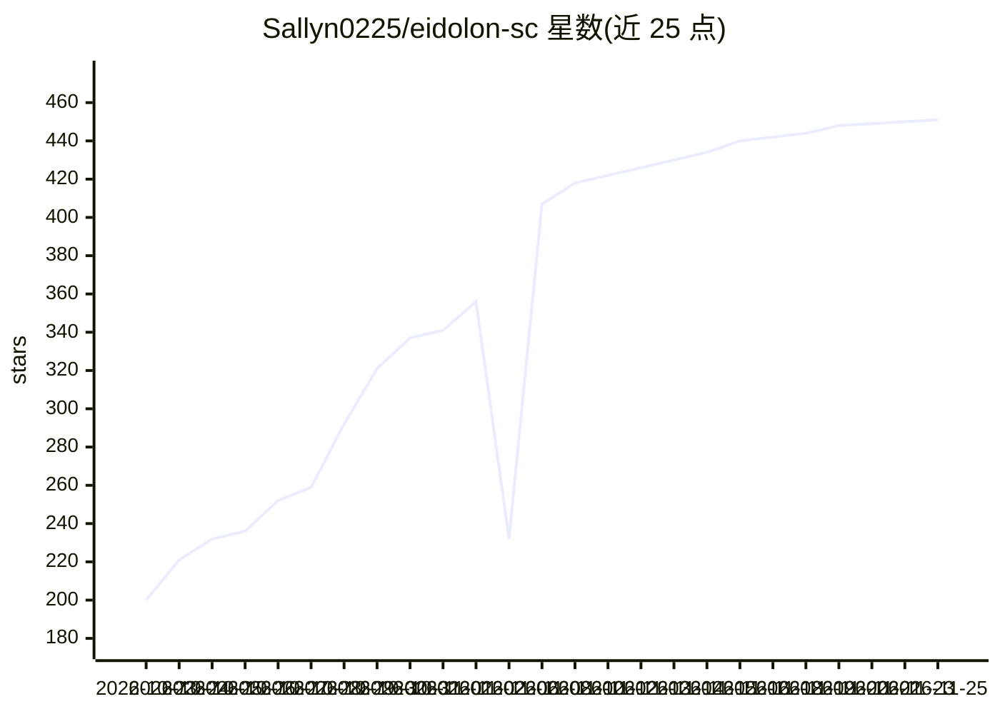

# Sallyn0225/eidolon-sc

⭐ 451 · Python · AGPL-3.0 · 推送 2026-11-23 · [GitHub](https://github.com/Sallyn0225/eidolon-sc) · [官网](http://283ai.hmhnk.top) · 个人维护 · 中文 README

**和闪耀色彩偶像实时语音/文字对话的 AI 分身**

以《偶像大师 闪耀色彩》28 位偶像及事务员为角色的 AI 对话应用：WebRTC 实时语音通话与文字聊天共用一个对话引擎，日语原声回答附中文字幕；通过导入剧情库实现角色回忆原作经历，跨角色共享记忆；附好感度、礼物、日程、周期、酒吧小游戏等玩法。FastAPI + Pipecat 后端、Next.js 前端，Docker Compose 部署，支持 Google/GitHub 登录与用户自带 LLM/语音密钥。剧情数据与立绘素材因版权不随仓库分发，需自行同步。

## 筛选速览

| 维度 | 判定 | 备注 |
|---|---|---|
| AI 角色 | `ai-native` | 本体是模型或模型工具 |
| 许可风险 | `viral` | AGPL-3.0 |
| 部署形态 | `self-host` | docker 或自建部署 |
| 模型依赖 | — | README 未给出锁定关系 |
| 硬件要求 | — | 无带数字的原话,不猜 |
| 安装摩擦 | `low` | 无编译、无系统依赖或容器化 |
| 成熟度 | — | 结构信号不足 |

## 能力要点

- WebRTC 全双工实时语音通话，日语原声+逐句中文字幕
- 按需检索剧情库，角色只回忆自己出场的原作情节；跨角色共享记忆
- 用户可自带 LLM/语音合成/识别/生图密钥，仅存浏览器
- Docker Compose 一键部署，自带 Caddy 自动 HTTPS 与 coturn 中继

## 适用场景

- 以制作人身份和喜爱的偶像打电话或打字聊天
- 部署到公网让其他粉丝登录与角色对话
- 让偶像记住并回忆原作剧情与用户说过的事

## 场景标签

`语音 Agent` `RAG` `聊天机器人` · 领域:对话与助手

## 证据(README 行号)

> L20: Eidolon-SC 让你以 **283 事务所制作人**的身份，和原作中的偶像打字聊天或者直接打电话。她用日语原声回答，附上中文字幕；能回忆自己在原作里经历过的剧情；还会记住你说过的事，并在偶像之间「传开」。
> L102: - 🔌 **服务可以替换**：模型支持 OpenAI Chat Completions、Responses 和 Anthropic Messages 三种接口；语音识别、向量化各有两家可选，判断模型有三家；每项服务都可以单独走网
> L156: - 打字和说话走**同一个对话引擎**，写进同一条对话记录；通话只是在引擎外面包了一层语音识别和语音合成。

## 星数曲线

2026-10-23 200 → 2026-11-25 451（+251）

---
*卡片 v1 · prompt 1.4 · 生成 2026-11-25 · 置信度 high · 依据 README sha `67ccd0e09e83` · [字段定义](../../DATASET.md)*
