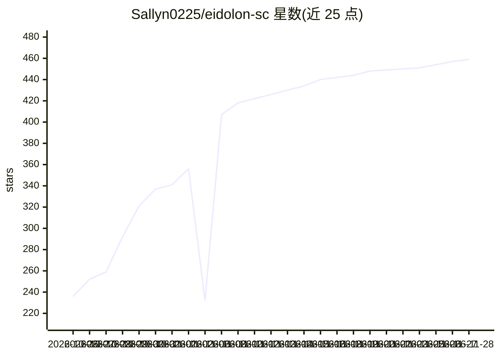

# Sallyn0225/eidolon-sc

⭐ 459 · Python · AGPL-3.0 · 推送 2026-11-26 · [GitHub](https://github.com/Sallyn0225/eidolon-sc) · [官网](http://283ai.hmhnk.top) · 个人维护 · 中文 README

**为《闪耀色彩》粉丝提供偶像实时语音/文字对话的 AI 分身应用**

面向《偶像大师 闪耀色彩》粉丝的非官方 Web 应用：用户以制作人身份与 28 位偶像打字聊天或 WebRTC 实时通话，模型以日语回答并附中文字幕。机制上依赖用户自备 LLM、语音合成/识别、向量化等服务密钥，剧情数据与立绘素材因版权不随仓库分发，需用仓库内工具自行同步。支持 Docker Compose 一键部署、Google/GitHub 登录、用户级记忆隔离与自带密钥功能。

## 筛选速览

| 维度 | 判定 | 备注 |
|---|---|---|
| AI 角色 | `ai-native` | 本体是模型或模型工具 |
| 许可风险 | `viral` | AGPL-3.0 |
| 部署形态 | `self-host` | docker 或自建部署 |
| 模型依赖 | — | README 未给出锁定关系 |
| 硬件要求 | — | 无带数字的原话,不猜 |
| 安装摩擦 | `low` | 无编译、无系统依赖或容器化 |
| 成熟度 | — | 结构信号不足 |

## 能力要点

- 基于 WebRTC 的全双工实时语音通话，日语原声配中文字幕，可插话打断
- 跨角色共享记忆与原作剧情回忆（RAG 按需检索），记忆可查看和删除
- 模型支持 OpenAI Chat Completions、Responses、Anthropic Messages 三种接口，各服务可替换
- Docker Compose 生产配置自带 Caddy（HTTPS）和 coturn（TURN 中继）

## 适用场景

- 部署后和喜欢的偶像角色实时语音/文字聊天
- 部署到公网让其他粉丝用 Google/GitHub 登录使用
- 让偶像回忆原作剧情并记住自己说过的话

## 场景标签

`语音 Agent` `聊天机器人` `RAG` · 领域:对话与助手

## 证据(README 行号)

> L3: **和《偶像大师 闪耀色彩》的偶像实时对话的 AI 分身**
> L20: Eidolon-SC 让你以 **283 事务所制作人**的身份，和原作中的偶像打字聊天或者直接打电话。她用日语原声回答，附上中文字幕；能回忆自己在原作里经历过的剧情；还会记住你说过的事，并在偶像之间「传开」。
> L102: - 🔌 **服务可以替换**：模型支持 OpenAI Chat Completions、Responses 和 Anthropic Messages 三种接口；语音识别、向量化各有两家可选，判断模型有三家；每项服务都可以单独走网

## 星数曲线

2026-10-26 236 → 2026-11-28 459（+223）

---
*卡片 v1 · prompt 1.4 · 生成 2026-11-27 · 置信度 high · 依据 README sha `6438098cccf4` · [字段定义](../../DATASET.md)*
