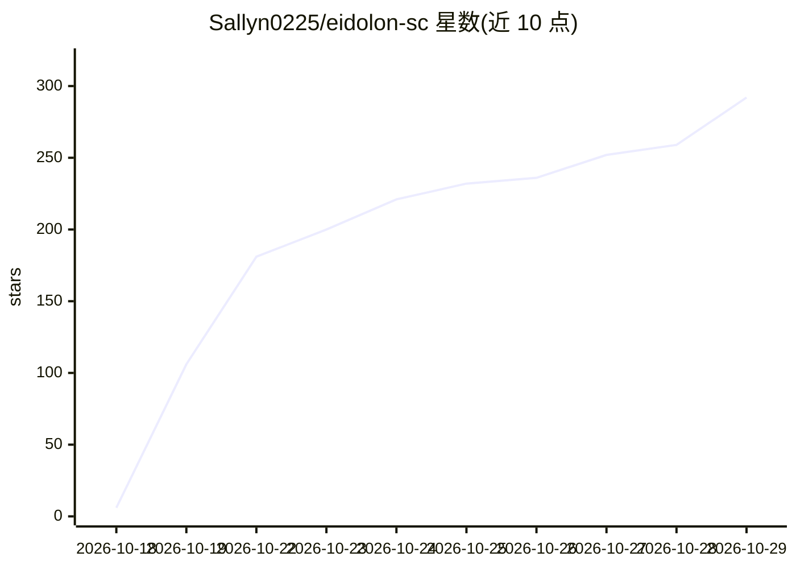

# Sallyn0225/eidolon-sc

⭐ 292 · Python · AGPL-3.0 · 推送 2026-10-27 · [GitHub](https://github.com/Sallyn0225/eidolon-sc) · 个人维护 · 中文 README

**与《闪耀色彩》偶像实时语音/文字对话的 AI 分身应用**

面向终端用户（以 283 事务所制作人身份）的自部署 Web 应用：与 28 位偶像及事务员进行 WebRTC 实时语音通话或文字聊天，日语原声回答附中文字幕，Spine 立绘随情绪变化。机制上基于 RAG 回忆原作剧情（剧情数据不随仓库分发、需自行准备）、跨角色共享记忆、好感度与礼物系统；模型支持 OpenAI 与 Anthropic 接口，语音识别/合成/向量化/生图服务可替换，用户可自带密钥。Docker Compose 一键部署，自带 Caddy 与 coturn；AGPL-3.0，非官方粉丝作品。

## 筛选速览

| 维度 | 判定 | 备注 |
|---|---|---|
| AI 角色 | `ai-native` | 本体是模型或模型工具 |
| 许可风险 | `viral` | AGPL-3.0 |
| 部署形态 | `self-host` | docker 或自建部署 |
| 模型依赖 | — | README 未给出锁定关系 |
| 硬件要求 | — | 无带数字的原话,不猜 |
| 安装摩擦 | `low` | 无编译、无系统依赖或容器化 |
| 成熟度 | — | 结构信号不足 |

## 能力要点

- WebRTC 全双工语音通话，日语原声 + 中文字幕，Spine 立绘随情绪变化
- 回忆原作剧情（按需检索）与跨角色共享记忆
- 对话模型支持 OpenAI Chat Completions/Responses 与 Anthropic Messages 三种接口
- Docker Compose 生产配置，自带 Caddy 自动 HTTPS 与 coturn TURN 中继

## 适用场景

- 和原作偶像打字聊天或直接语音通话
- 部署到公网供多人使用，支持 Google/GitHub 登录与用户自带密钥
- 让偶像记住说过的事并在角色之间传递

## 场景标签

`语音 Agent` `聊天机器人` · 领域:对话与助手

## 证据(README 行号)

> L20: Eidolon-SC 让你以 **283 事务所制作人**的身份，和原作中的偶像打字聊天或者直接打电话。她用日语原声回答，附上中文字幕；能回忆自己在原作里经历过的剧情；还会记住你说过的事，并在偶像之间「传开」。
> L62: - 🎙️ **实时语音通话**：基于 WebRTC 的全双工通话，中文、日语都能说，随时可以插话打断她。

## 星数曲线

2026-10-18 6 → 2026-10-29 292（+286）

---
*卡片 v1 · prompt 1.4 · 生成 2026-10-22 · 置信度 high · 依据 README sha `c7e42cf1387e` · [字段定义](../../DATASET.md)*
