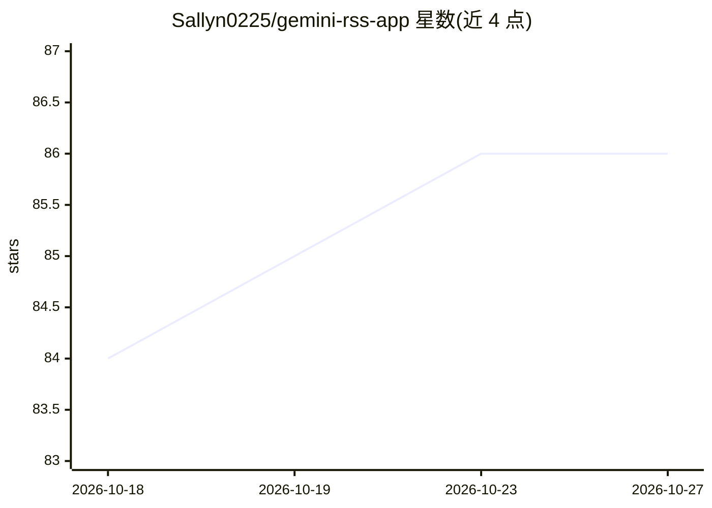

# Sallyn0225/gemini-rss-app

⭐ 86 · TypeScript · MIT · 推送 2026-03-03 · [GitHub](https://github.com/Sallyn0225/gemini-rss-app) · [官网](https://nsyc.sallyn.top/) · 个人维护 · 中文 README

**面向多媒体企划/声优情报的 RSS 聚合 + AI 翻译总结阅读器**

Web 应用，聚合多个 RSS 源（官方账号、企划情报、活动信息），提供列表/网格阅读、日历按日筛选、一键 AI 生成当日总结、多语言翻译与内容自动分类打标签。用户可自配 API（OpenAI 兼容 / OpenAI Responses / Gemini / Anthropic），可为翻译、总结、分析任务分别指定模型；API Key 仅存浏览器本地。文章全文提取采用三层策略（RSS 全文 → 客户端 Readability → 服务端回退），含 SSRF 防护、域名白名单与限流。支持 Vercel+Neon 或 Cloudflare Pages+D1 两种 Serverless 部署。

## 筛选速览

| 维度 | 判定 | 备注 |
|---|---|---|
| AI 角色 | `ai-native` | 本体是模型或模型工具 |
| 许可风险 | `permissive` | MIT |
| 部署形态 | `library` | 以包/库形式分发 |
| 模型依赖 | — | README 未给出锁定关系 |
| 硬件要求 | — | 无带数字的原话,不猜 |
| 安装摩擦 | `low` | 无编译、无系统依赖或容器化 |
| 成熟度 | — | 结构信号不足 |

## 能力要点

- 多源 RSS 订阅、按日筛选与一键 AI 日总结
- AI 翻译与内容自动分类（官方公告/媒体宣发/线下活动等）
- 兼容 OpenAI / Gemini / Anthropic 等多种 API 格式，Key 仅存浏览器本地
- 三层文章全文提取策略与 SSRF/白名单/限流安全防护

## 适用场景

- 订阅并阅读多媒体企划/声优相关多源资讯
- 把日语等外文资讯一键翻译为中文并自动分类
- 回顾任意日期更新并生成当日 AI 总结
- 零编程经验下在 Vercel 或 Cloudflare Pages 免费部署

## 场景标签

`AI 写作` `网页抓取` · 领域:效率与自动化

## 证据(README 行号)

> L9: - 可配置自有大模型 API（OpenAI 兼容 / OpenAI Responses / Gemini / Anthropic）完成翻译、日总结、分类打标签
> L38: - **AI 翻译与分类**：
> L92: 2. 添加 API 提供商（OpenAI 兼容 / OpenAI Responses / Gemini / Anthropic）

## 星数曲线

2026-10-18 84 → 2026-10-27 86（+2）

---
*卡片 v1 · prompt 1.4 · 生成 2026-10-24 · 置信度 high · 依据 README sha `38e70b507f27` · [字段定义](../../DATASET.md)*
