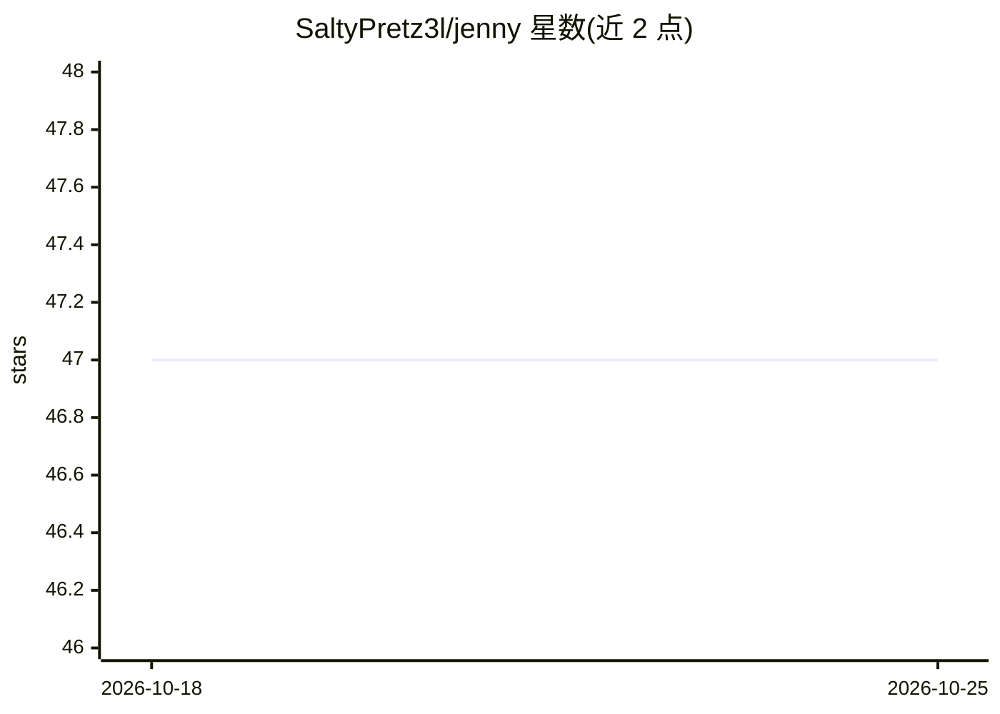

# SaltyPretz3l/jenny

⭐ 47 · JavaScript · MIT · 推送 2026-10-24 · [GitHub](https://github.com/SaltyPretz3l/jenny) · 个人维护

**本地优先的桌面 AI 编程助手，用本地模型写代码、改文件、跑命令**

面向使用者的桌面端 AI 编程工具（Electron）：以对话驱动写代码、编辑文件、运行命令、生成图表，所有步骤可见、行动前需确认，并内置带终端的 Workspace IDE。默认面向 9B–35B 本地小模型，可接 Ollama、自管 llama-server、vLLM 或任意 OpenAI 兼容服务端，对话保存在本机；也可用可选的 ChatGPT 登录走云端推理。1.5.0 加入跨会话记忆、聊天间协作、Git/命令提案与 MCP 斜杠命令。Windows 为受支持平台，Linux/macOS 安装包为实验性；需自备模型服务端。

## 筛选速览

| 维度 | 判定 | 备注 |
|---|---|---|
| AI 角色 | `ai-native` | 本体是模型或模型工具 |
| 许可风险 | `permissive` | MIT |
| 部署形态 | `desktop` | 安装包/桌面程序 |
| 模型依赖 | local-ok | 支持本地模型 |
| 硬件要求 | — | 无带数字的原话,不猜 |
| 安装摩擦 | `low` | 无编译、无系统依赖或容器化 |
| 成熟度 | `idea` | |

## 能力要点

- 本地模型处理提示词，无需云账号，对话保存在本机
- 支持 Ollama/vLLM/自管 llama-server/OpenAI 兼容服务端多种模型路由
- 每步可见、行动前需批准，diff 卡片展示确切变更
- 内置 Workspace IDE（Monaco 编辑器、终端、Git gutter）

## 适用场景

- 在本地模型辅助下编写和修改项目代码
- 通过对话让助手执行文件操作与命令并逐一审批
- 在不依赖云账号的私有环境中完成编程任务

## 场景标签

`编码 Agent` `AI 助手` · 领域:编码与开发

## 证据(README 行号)

> L3: **Jenny is an AI coding harness that keeps you in the loop.** It is built for local models and works with cloud ones
> L5: Jenny is a desktop app. She can help you write code, edit files, run commands, and make charts and diagrams. You cho
> L7: With a local model, Jenny processes your prompts locally; no cloud account is needed. You can use Ollama, managed ll

## 星数曲线

2026-10-18 47 → 2026-10-25 47（+0）

---
*卡片 v1 · prompt 1.4 · 生成 2026-10-25 · 置信度 mid · 依据 README sha `646a09304769` · [字段定义](../../DATASET.md)*
