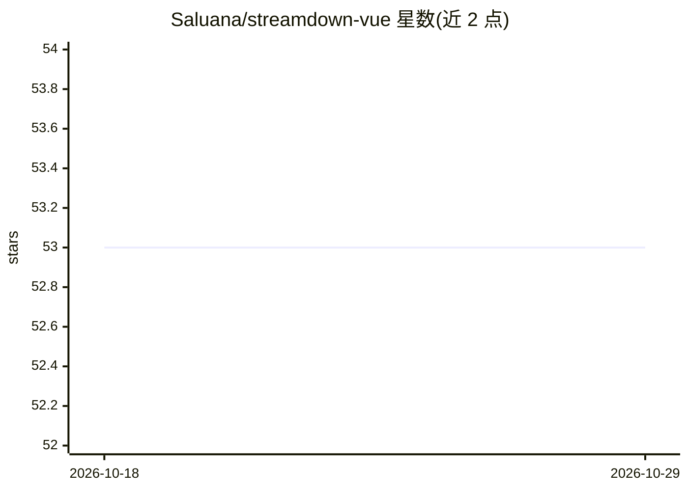

# Saluana/streamdown-vue

⭐ 53 · TypeScript · NOASSERTION · 推送 2026-10-23 · [GitHub](https://github.com/Saluana/streamdown-vue) · 个人维护

**Vue 3/Nuxt 3 的流式 Markdown 渲染组件，供 LLM 输出逐块展示**

提供 `<StreamMarkdown>` Vue 组件，将到达中的 Markdown 文本（token/块级）增量渲染，并附带 `parseIncompleteMarkdown`、`parseBlocks` 等工具修复流式传输中的不完整标记。功能含 GFM 表格、KaTeX 数学、Shiki 双主题高亮（带复制/下载按钮）、Mermaid 图、链接/图片前缀白名单安全加固、组件覆盖层与 `data-streamdown` 属性便于样式与测试；支持 SSR 与快速水合。面向在 Vue/Nuxt 中构建 LLM 流式聊天界面的开发者。限制：不暴露内容插槽（AST 驱动管线），流式修复需在组件外用工具函数完成。

## 筛选速览

| 维度 | 判定 | 备注 |
|---|---|---|
| AI 角色 | `ai-ecosystem` | LLM/agent 周边工具 |
| 许可风险 | `none` | NOASSERTION |
| 部署形态 | `library` | 以包/库形式分发 |
| 模型依赖 | — | README 未给出锁定关系 |
| 硬件要求 | — | 无带数字的原话,不猜 |
| 安装摩擦 | `low` | 无编译、无系统依赖或容器化 |
| 成熟度 | — | 结构信号不足 |

## 能力要点

- 流式增量渲染 + 不完整 Markdown 标记修复工具
- Shiki 双主题高亮与可扩展代码块操作栏
- 链接/图片 URL 前缀白名单安全模型
- 全元素 `data-streamdown` 属性支持自定义样式与测试

## 适用场景

- 在 Vue/Nuxt 聊天界面中实时渲染 LLM 流式回复
- 对 AI 输出做带数学公式、图表、代码高亮的展示
- 通过组件覆盖层嵌入自定义 Vue 组件定制渲染

## 场景标签

 · 领域:LLM 前端/组件库

## 证据(README 行号)

> L3: `streamdown-vue` brings Streamdown-style streaming Markdown to Vue 3 & Nuxt 3. It ships a `<StreamMarkdown>` compone
> L155: ## 5. Deep Dive Tutorial – Live Streaming (AI / SSE)

## 星数曲线

2026-10-18 53 → 2026-10-29 53（+0）

---
*卡片 v1 · prompt 1.4 · 生成 2026-10-24 · 置信度 high · 依据 README sha `f3bde082b11f` · [字段定义](../../DATASET.md)*
