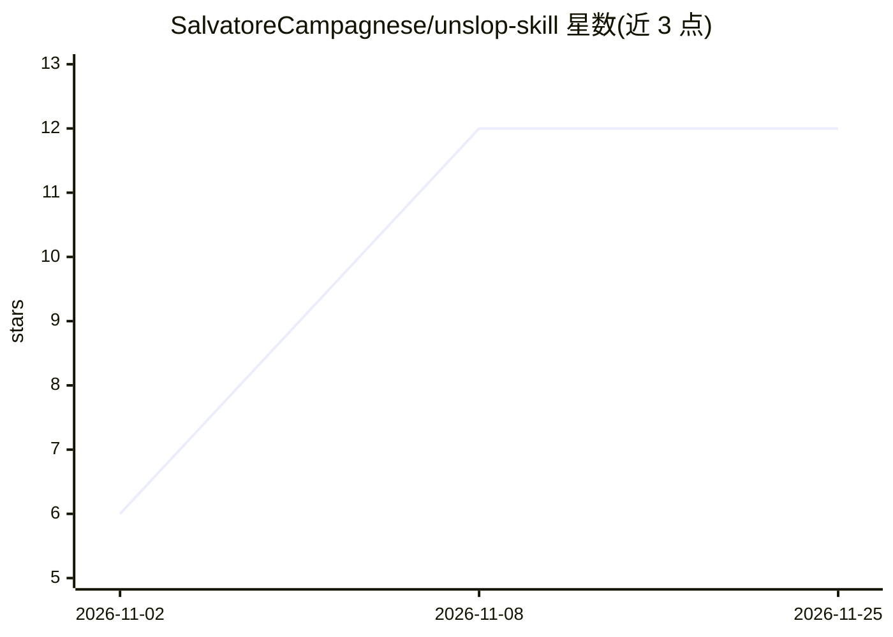

# SalvatoreCampagnese/unslop-skill

⭐ 12 · JavaScript · MIT · 推送 2026-11-01 · [GitHub](https://github.com/SalvatoreCampagnese/unslop-skill) · 个人维护

**检测并修复 UI 与文案中的 AI 模板化痕迹的编码 agent 技能**

unslop 是一个面向编码 agent（Claude Code 及任何读取 SKILL.md 的 agent）的技能，另附三个零依赖的独立扫描脚本：分别检查前端源码、散文文本，以及用 headless Chrome 在三种宽度实测渲染结果（文字重叠、溢出、对比度、点击目标等）。内置约 90 条规则（约 50 条可静态检查），按 P0-P2 分级，采用密度聚类计分而非单次命中即报；支持品牌调色板与样式配置文件声明豁免，退出码 2 可直接用作 CI 门槛。规则均为启发式，无 AI 概率评分。

## 筛选速览

| 维度 | 判定 | 备注 |
|---|---|---|
| AI 角色 | `ai-ecosystem` | LLM/agent 周边工具 |
| 许可风险 | `permissive` | MIT |
| 部署形态 | `None` |  |
| 模型依赖 | — | README 未给出锁定关系 |
| 硬件要求 | — | 无带数字的原话,不猜 |
| 安装摩擦 | `low` | 无编译、无系统依赖或容器化 |
| 成熟度 | — | 结构信号不足 |

## 能力要点

- 约 90 条 UI 与文本模板化痕迹规则，按 P0-P2 严重度分级
- 三个零依赖 Node 扫描脚本，可独立运行或接入 CI（退出码 2 作门槛）
- headless Chrome 在 1280/768/420px 实测渲染，检查重叠、裁切、对比度
- unslop.palette.json / unslop.style.json 声明品牌决策，声明后对应规则豁免

## 适用场景

- 上线前扫描前端代码与文案中的模板化 AI 痕迹
- 在 CI 中设置分数门槛拦截模板化的页面改动
- 用调色板/样式配置文件防止团队 UI 风格漂移
- 检查页面在手机宽度下是否真的渲染正常

## 场景标签

 · 领域:开发工具/代码与文案质量检查

## 证据(README 行号)

> L15: It is a skill for coding agents (Claude Code and any agent that reads
> L43: node scripts/detect-ui.mjs    src/             # frontend source
> L62: Exit code `2` means over threshold, so it drops into CI as-is.

## 星数曲线

2026-11-02 6 → 2026-11-25 12（+6）

---
*卡片 v1 · prompt 1.4 · 生成 2026-11-18 · 置信度 high · 依据 README sha `dd64661f4b15` · [字段定义](../../DATASET.md)*
