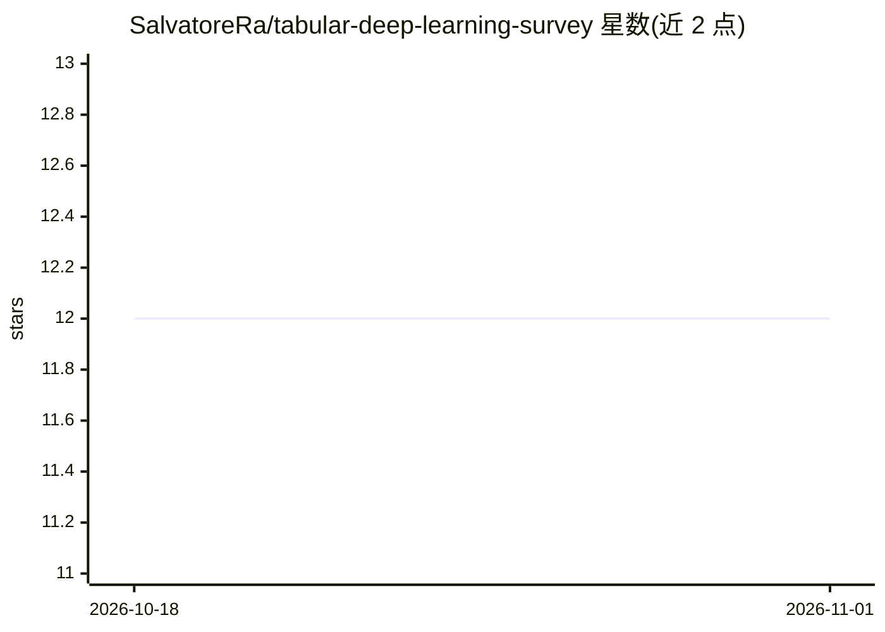

# SalvatoreRa/tabular-deep-learning-survey

⭐ 12 · Jupyter Notebook · 推送 2026-04-27 · [GitHub](https://github.com/SalvatoreRa/tabular-deep-learning-survey) · [官网](https://www.techrxiv.org/doi/full/10.36227/techrxiv.175753732.26052568) · 个人维护

**表格深度学习综述的配套论文清单，按方法类别编目**

Salvatore Raieli 所著综述 'Tabular Deep Learning: A Survey from Small Neural Networks to Large Language Models' 的配套 GitHub 仓库。以分类表格形式收录 2016–2025 年表格数据深度学习论文及代码链接，覆盖数据编码、神经集成、正则化、专用架构（MLP 替代/增强、全/半可微）、Transformer 变体与基础模型等类别。提供 BibTeX 与 Chicago 引用格式，survey 已于 2025 年发表，读者可通过 issue 反馈缺失论文，新版本在准备中。

## 筛选速览

| 维度 | 判定 | 备注 |
|---|---|---|
| AI 角色 | `ai-knowledge` | 知识聚合/清单类 |
| 许可风险 | `none` | — |
| 部署形态 | `None` |  |
| 模型依赖 | — | README 未给出锁定关系 |
| 硬件要求 | — | 无带数字的原话,不猜 |
| 安装摩擦 | `low` | 无编译、无系统依赖或容器化 |
| 成熟度 | — | 结构信号不足 |

## 能力要点

- 按 7+ 个方法类别组织的论文-代码对照表
- 覆盖 2016–2025 年从早期 MLP 到 Transformer 与基础模型的表格深度学习研究
- 条目附带开源代码链接
- survey 已于 2025 年发表（IEEE/TechRxiv）

## 适用场景

- 查找表格数据深度学习各方法类别下的代表性论文与代码
- 为表格数据建模任务做模型选型时的文献检索
- 了解表格深度学习领域从 MLP 到 LLM 的发展脉络

## 场景标签

`精选清单` · 领域:学习与行业

## 证据(README 行号)

> L1: # Tabular Deep Learning: A Survey from Small Neural Networks to Large Language Models
> L3: This repository is the companion GitHub Project for Tabular Deep Learning: A Survey from Small Neural Networks to La
> L16: Tabular data remains the most prevalent data format across industries such as finance, healthcare, and cybersecurit
> L18: From early MLPs to recent transformer-based architectures and the emergence of foundation models, we cover key chal

## 星数曲线

2026-10-18 12 → 2026-11-01 12（+0）

---
*卡片 v1 · prompt 1.4 · 生成 2026-11-01 · 置信度 high · 依据 README sha `aed86bfe28ad` · [字段定义](../../DATASET.md)*
