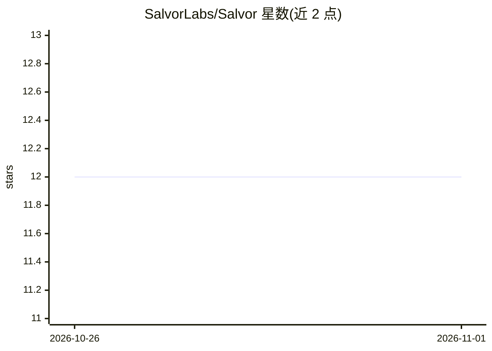

# SalvorLabs/Salvor

⭐ 12 · Shell · MIT · 推送 2026-09-22 · [GitHub](https://github.com/SalvorLabs/Salvor) · [官网](https://salvorknows.dev/) · 组织维护

**给编码代理的仓库内工程知识层：留存决策、失败与待办**

面向编码代理与软件团队的仓库级知识治理层：以纯 Markdown 的 .salvor/ 目录存放经人批准的设计决策、领域学习、失败教训（LF 注册表）与延迟发现，配 CLAUDE.md 枢纽及 AGENTS.md/GEMINI.md 薄适配器接入 Claude Code、Codex 等代理。采用 prompt-first 安装：粘贴 SETUP_PROMPT.md 并回答四个问题即完成脚手架，升级通过协议戳仅提出增量。默认模式下知识入库需人工批准；Core 模式无需 MCP，增强模式额外引入 Serena 与 GitNexus 提供符号导航与影响分析。

## 筛选速览

| 维度 | 判定 | 备注 |
|---|---|---|
| AI 角色 | `ai-ecosystem` | LLM/agent 周边工具 |
| 许可风险 | `permissive` | MIT |
| 部署形态 | `library` | 以包/库形式分发 |
| 模型依赖 | — | README 未给出锁定关系 |
| 硬件要求 | — | 无带数字的原话,不猜 |
| 安装摩擦 | `low` | 无编译、无系统依赖或容器化 |
| 成熟度 | `idea` | |

## 能力要点

- 三类捕获：决策/领域学习、失败教训（LF 注册表）、延迟发现，默认入库前需人工批准
- 全部知识以纯 Markdown 存于仓库内，可在 PR 中审查、可 diff、可分支
- prompt-first 安装与升级：SETUP_PROMPT.md 单文件，升级读取 Salvor-Protocol 戳仅应用协议增量
- 存量文档可按章节级映射采纳，源文件默认不变更
- Core 模式无需 MCP 服务器；增强模式加入 Serena 符号导航与 GitNexus 图影响分析

## 适用场景

- 让新的 agent 会话继承项目已积累的决策与失败教训，避免重蹈覆辙
- 团队在 PR 流程中审查和沉淀工程知识
- 切换编码代理厂商时保留同一份项目知识
- 将已有 ADR、postmortem、runbook 映射进统一知识层

## 场景标签

`Agent 记忆` `知识库管理` · 领域:Agent 开发

## 证据(README 行号)

> L36: Salvor is a **repo-native engineering knowledge layer and governance protocol
> L75: project knowledge. Setup generates contract-tested entrypoints for Claude Code,

## 星数曲线

2026-10-26 12 → 2026-11-01 12（+0）

---
*卡片 v1 · prompt 1.4 · 生成 2026-11-01 · 置信度 mid · 依据 README sha `8eed952dbfc4` · [字段定义](../../DATASET.md)*
