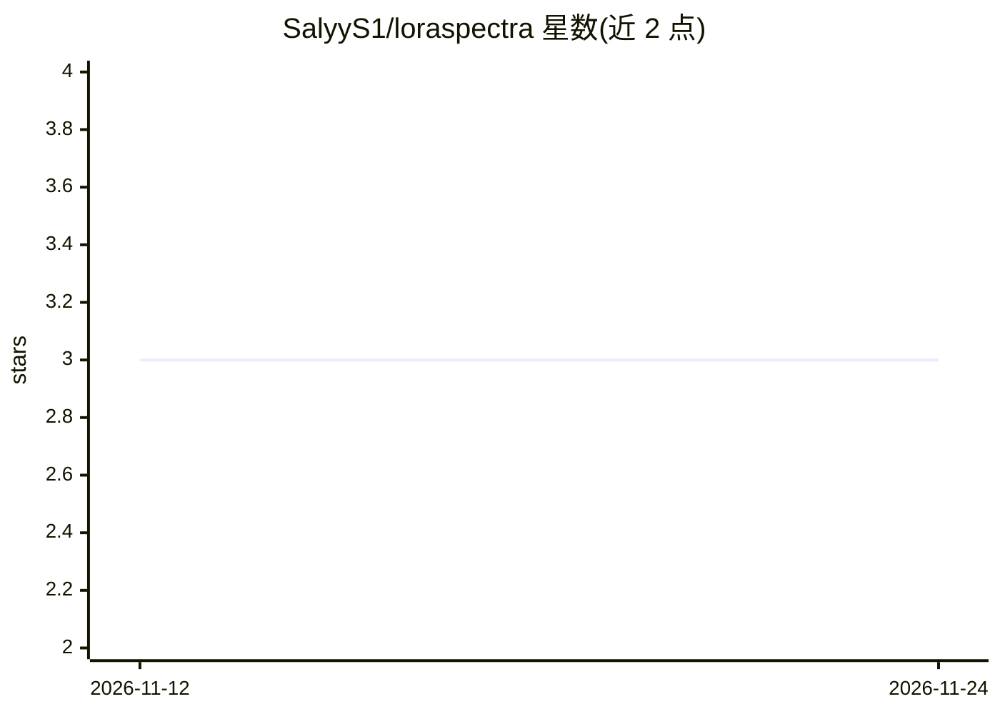

# SalyyS1/loraspectra

⭐ 3 · Rust · MIT · 推送 2026-11-19 · [GitHub](https://github.com/SalyyS1/loraspectra) · [官网](https://salyys1.github.io/loraspectra/) · 个人维护

**LoRA 适配器的 SVD 审计、压缩与合并 CLI 工具**

零依赖的 Rust 引擎与 CLI，用于审计、压缩与合并 .safetensors 格式的 LoRA 适配器权重。核心机制是通过 QR 分解将奇异值分解降到小核心矩阵，避免加载 PyTorch/GPU 运行时。功能覆盖适配器完整性诊断（零范数、量化损坏、rsLoRA/PiSSA/DoRA 异常）、基于 Eckart-Young 的动态秩压缩、N 适配器正交子空间合并、模型卡审计报告生成、SARIF CI 门禁导出，并提供纯浏览器端的交互式 SVD 检查器。面向训练和合并 LoRA 模型的开发者。

## 筛选速览

| 维度 | 判定 | 备注 |
|---|---|---|
| AI 角色 | `ai-ecosystem` | LLM/agent 周边工具 |
| 许可风险 | `permissive` | MIT |
| 部署形态 | `library` | 以包/库形式分发 |
| 模型依赖 | — | README 未给出锁定关系 |
| 硬件要求 | — | 无带数字的原话,不猜 |
| 安装摩擦 | `high` | 编译与系统依赖俱全 |
| 成熟度 | — | 结构信号不足 |

## 能力要点

- 零依赖 Rust 引擎，无需加载 PyTorch 或 GPU 运行时即可处理 .safetensors 权重
- 支持 NF4/FP4/INT4/INT8 低比特量化权重的解包与重建误差审计
- Eckart-Young 最优秩压缩与 N 适配器 ortho-svd/TIES/DARE 合并
- 浏览器端 100% 客户端 SVD 检查器，文件零上传，可直接拖入 HuggingFace/Kohya/ComfyUI 格式

## 适用场景

- 训练完 LoRA 后检查是否出现秩坍缩或死层
- 在保持能量占比的前提下压缩 LoRA 文件体积
- 合并多个 LoRA 适配器前评估子空间干扰
- 在 CI 流水线中用 SARIF 报告拦截微调缺陷

## 场景标签

`微调` · 领域:训练与推理

## 证据(README 行号)

> L8: `loraspectra` (`v1.8.0`) is a zero-dependency Rust engine, CLI, and client-side Web Inspector for auditing, initiali
> L43: 7. **Automated Subspace Interference Merge Advisor, N-Adapter `ortho-svd` Merge & Scale Baking (`interference` / `m
> L48: 8. **OASIS SARIF v2.1.0 Code Scanning & CI Gate (`audit` / `merge-check` / `ties-dare` / `lora-ga` / `project` / `k

## 星数曲线

2026-11-12 3 → 2026-11-24 3（+0）

---
*卡片 v1 · prompt 1.4 · 生成 2026-11-22 · 置信度 high · 依据 README sha `f84bd0450567` · [字段定义](../../DATASET.md)*
