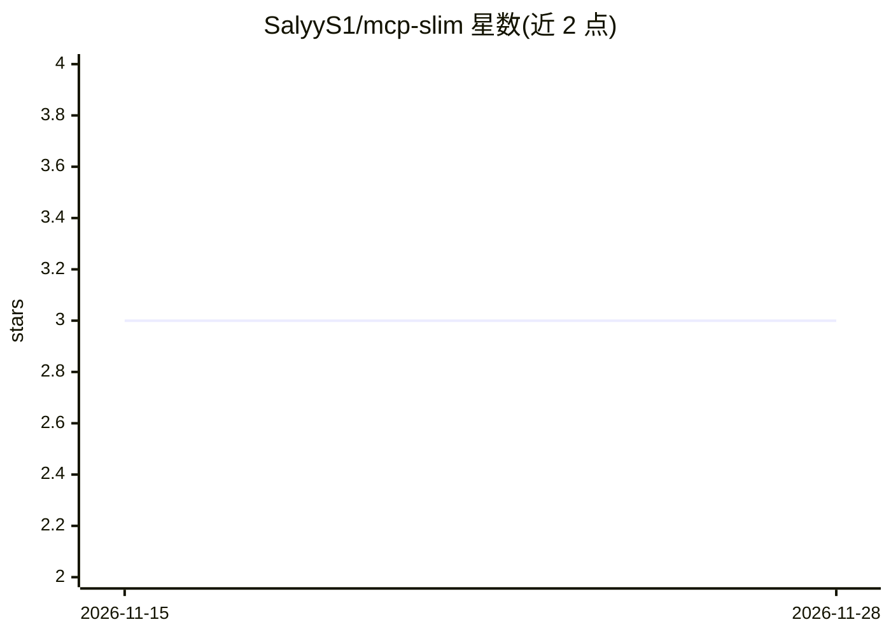

# SalyyS1/mcp-slim

⭐ 3 · Python · MIT · 推送 2026-11-18 · [GitHub](https://github.com/SalyyS1/mcp-slim) · [官网](https://salyys1.github.io/mcp-slim/) · 个人维护

**面向 MCP 客户端的 stdio 代理：压缩工具 schema token 并遮蔽泄漏密钥**

零依赖的 Python 3.10+ stdio 代理，运行在 MCP 客户端（如 Claude Code、Cursor、Windsurf）与上游 MCP 服务器之间。提供两种模式：标准模式原地压缩 tools/list schema 与 tools/call 输出并内联 $defs/$ref 指针；惰性发现模式将静态工具定义替换为 2 个按需元工具（BM25 排序检索 + 调用）。附带密钥遮蔽（12 类凭据）、通配符工具过滤、SHA-256 schema 固定、SARIF 安全审计及累计成本统计，可通过 uvx/npx 零安装运行。

## 筛选速览

| 维度 | 判定 | 备注 |
|---|---|---|
| AI 角色 | `ai-ecosystem` | LLM/agent 周边工具 |
| 许可风险 | `permissive` | MIT |
| 部署形态 | `library` | 以包/库形式分发 |
| 模型依赖 | local-ok | 支持本地模型 |
| 硬件要求 | — | 无带数字的原话,不猜 |
| 安装摩擦 | `low` | 无编译、无系统依赖或容器化 |
| 成熟度 | — | 结构信号不足 |

## 能力要点

- 零依赖，通过 uvx/npx 零安装或 pip/uv 安装
- 标准模式压缩 schema/输出，惰性模式以 2 个元工具按需发现工具
- 递归 $defs/$ref 内联，消除 Gemini/Vertex/vLLM/Ollama 端点的 schema 拒绝
- 实时密钥遮蔽、20 条 SARIF 规则与 GitHub Action CI 审计

## 适用场景

- 接入多个 MCP 服务器时降低上下文窗口的 token 消耗
- 修复客户端连接 Gemini/Vertex 等端点时的 $defs/$ref 报错
- 防止 MCP 工具输出把 API 密钥等凭据泄漏进 LLM 上下文
- 在 CI 中对 MCP 配置做 schema 与安全审计

## 场景标签

 · 领域:LLM 基础设施/MCP 工具链

## 证据(README 行号)

> L27: `mcp-slim` is a transparent, zero-dependency Python 3.10+ stdio proxy that sits between any MCP client and upstream
> L29: - **Lazy Discovery Mode (`mcp-slim run --lazy -- ...`):** Replaces 40-100+ static tool definitions with 2 lightweig

## 星数曲线

2026-11-15 3 → 2026-11-28 3（+0）

---
*卡片 v1 · prompt 1.4 · 生成 2026-11-22 · 置信度 high · 依据 README sha `0977bc28ff99` · [字段定义](../../DATASET.md)*
