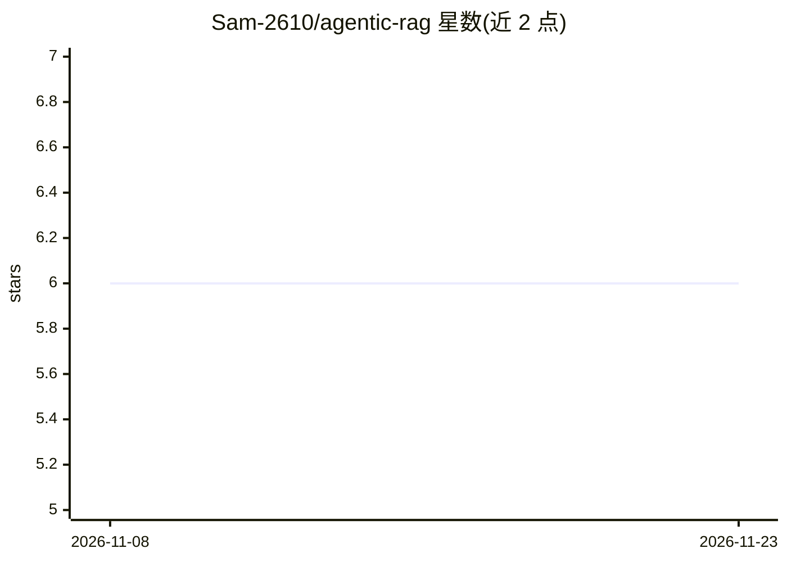

# Sam-2610/agentic-rag

⭐ 6 · Python · 推送 2026-11-21 · [GitHub](https://github.com/Sam-2610/agentic-rag) · 个人维护

**多 agent RAG 问答系统：路由到引文问答、代码分析或聊天**

基于 LangGraph 构建的多 agent RAG 系统：LLM 意图路由将每条消息分配到聊天、带引文的文档问答或受限 Python 代码 agent（写代码、运行、最多 3 次错误反馈重试，AST 白名单沙箱隔离执行）。文档分块嵌入后存入 ChromaDB，答案附 [1] 式引文与文件页码；LangGraph checkpointer 保存会话记忆。提供 FastAPI 后端与 Chainlit 聊天界面、pytest 测试与 17 条消息的评估脚本，README 公布两次运行的评估指标及其调参过程。作者提示沙箱为 best-effort 保护，不应公开暴露。

## 筛选速览

| 维度 | 判定 | 备注 |
|---|---|---|
| AI 角色 | `ai-native` | 本体是模型或模型工具 |
| 许可风险 | `none` | — |
| 部署形态 | `self-host` | docker 或自建部署 |
| 模型依赖 | — | README 未给出锁定关系 |
| 硬件要求 | — | 无带数字的原话,不猜 |
| 安装摩擦 | `low` | 无编译、无系统依赖或容器化 |
| 成熟度 | — | 结构信号不足 |

## 能力要点

- LLM 意图路由 + Pydantic 校验，无效输出回退关键词规则
- 受限 Python 代码 agent：写/跑/修代码完成计算与图表
- AST 白名单沙箱：独立进程、无文件读取、超时控制
- 17 条消息评估脚本，公布路由准确率与答案正确率指标

## 适用场景

- 对本地文档提问并获得带页码引文的回答
- 让 agent 写 Python 对文档中的数字做计算和画图
- 学习多 agent RAG 系统的结构与评估方法

## 场景标签

`多智能体` `文档问答` `RAG` · 领域:Agent 开发

## 证据(README 行号)

> L3: A multi-agent RAG system built with **LangGraph**. It routes each message to the right tool: answer from documents w
> L14: - **Router:** an LLM classifies the intent and returns JSON that is validated with Pydantic. Simple greetings skip 

## 星数曲线

2026-11-08 6 → 2026-11-23 6（+0）

---
*卡片 v1 · prompt 1.4 · 生成 2026-11-20 · 置信度 high · 依据 README sha `4338b2ed7349` · [字段定义](../../DATASET.md)*
