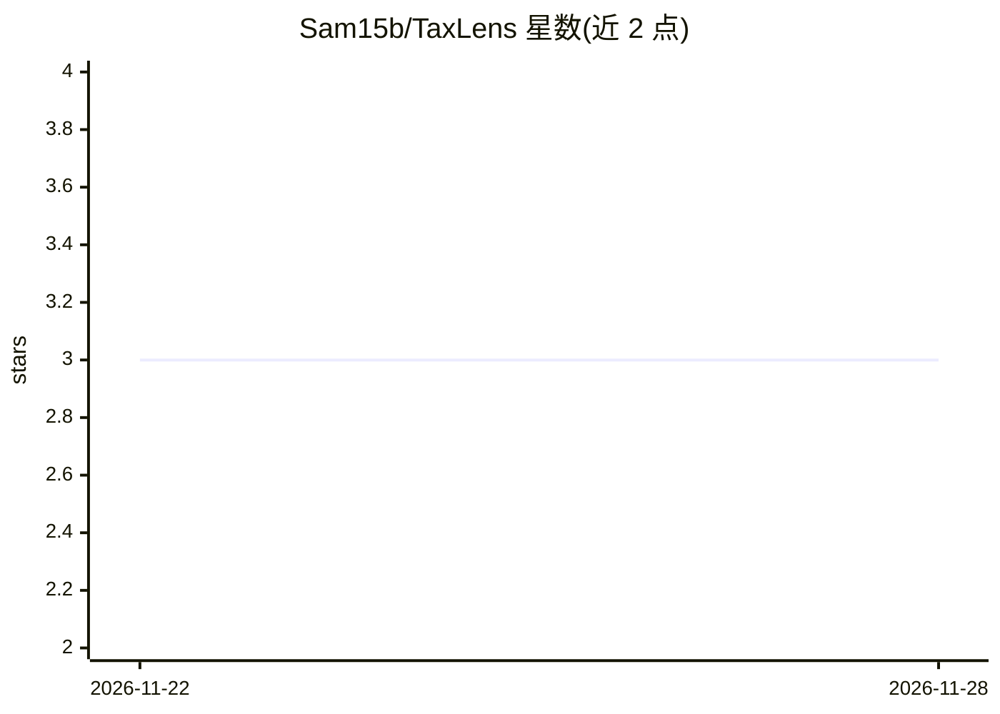

# Sam15b/TaxLens

⭐ 3 · Python · MIT · 推送 2026-11-09 · [GitHub](https://github.com/Sam15b/TaxLens) · 个人维护

**印度税法问答助手：带引用核验与 PII 掩码的 RAG 系统**

面向印度税法（1961 与 2025 所得税法、CBDT 通告、GST 通知）的文档问答与审查系统，每条回答带 [S#] 引用并在返回前校验引用与检索源一致；上传的客户文档在进入 LLM 前用 Presidio 掩码 PAN/Aadhaar 等 PII。检索用 Pinecone 混合索引（BGE 稠密 + SPLADE 稀疏，RRF 与法条号加权），LangGraph 路由问答/文档审查/计税器，CI 中以约 100 题金标集作 PR 评测门槛。部署在 Azure 免费层。项目处于 Sprint 阶段，评测基线未完成。

## 筛选速览

| 维度 | 判定 | 备注 |
|---|---|---|
| AI 角色 | `ai-native` | 本体是模型或模型工具 |
| 许可风险 | `permissive` | MIT |
| 部署形态 | `self-host` | docker 或自建部署 |
| 模型依赖 | local-ok | 支持本地模型 |
| 硬件要求 | — | 无带数字的原话,不猜 |
| 安装摩擦 | `low` | 无编译、无系统依赖或容器化 |
| 成熟度 | `idea` | |

## 能力要点

- 引用强制核验：[S1] 引用不通过则不作为带来源回答返回
- CI 评测门：每次 PR 运行约 100 题金标集，低于阈值即失败
- PII 先行掩码：Presidio + 印度定制识别器，文本到 LLM 前处理
- 多租户隔离：每工作区独立 Pinecone namespace 与追加式审计日志

## 适用场景

- 查询印度所得税法、CBDT 通告与 GST 通知并获得带出处引用的回答
- 上传客户税务文档做审查并自动掩码个人敏感信息
- 确定性地计算 FY 2025-26 税额

## 场景标签

`文档问答` `RAG` · 领域:知识与检索

## 证据(README 行号)

> L8: **An AI tax & legal document assistant for Indian tax law.** It answers questions about the
> L16: > `[S#]` citations or "not found". Sprint 2, days 7–8: the LangGraph router (qa / calc / refuse)

## 星数曲线

2026-11-22 3 → 2026-11-28 3（+0）

---
*卡片 v1 · prompt 1.4 · 生成 2026-11-22 · 置信度 high · 依据 README sha `3dfcffc69d0f` · [字段定义](../../DATASET.md)*
