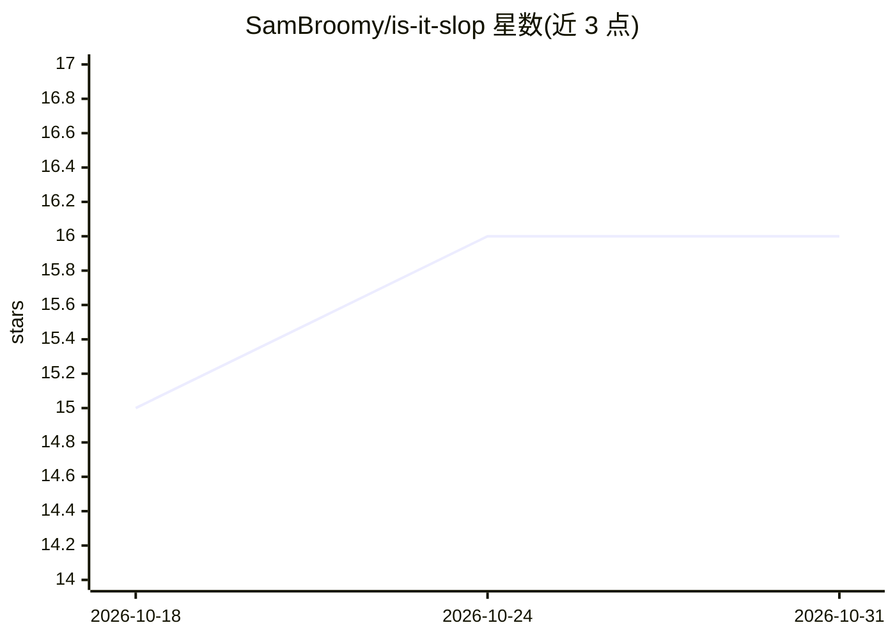

# SamBroomy/is-it-slop

⭐ 16 · Rust · MIT · 推送 2026-06-10 · [GitHub](https://github.com/SamBroomy/is-it-slop) · 个人维护

**检测文本是否为 AI 生成的轻量分类器（Rust 二进制+多语言绑定）**

基于 TF-IDF 与 token n-gram（tiktoken o200k_base BPE，2-4 gram）特征、线性模型堆叠集成（SGD/逻辑回归/Linear SVC/朴素贝叶斯+元学习器）的 AI 文本检测器，导出为 ONNX 由 Rust 运行时推理。单个约 60MB 二进制内嵌模型产物，无需 GPU、无 Python 运行时；长文档按 150 token 重叠分块加权聚合。在 25+ 数据集约 687K 样本上训练，留出集准确率 95.6%。提供 CLI、Python/Rust 库与 Android AAR 四种接口，跨 macOS/Linux/Windows 平台。

## 筛选速览

| 维度 | 判定 | 备注 |
|---|---|---|
| AI 角色 | `ai-native` | 本体是模型或模型工具 |
| 许可风险 | `permissive` | MIT |
| 部署形态 | `library` | 以包/库形式分发 |
| 模型依赖 | — | README 未给出锁定关系 |
| 硬件要求 | — | 无带数字的原话,不猜 |
| 安装摩擦 | `medium` | 含编译或系统依赖之一 |
| 成熟度 | — | 结构信号不足 |

## 能力要点

- TF-IDF + 4 分类器堆叠集成，ONNX 导出，Rust 多线程推理
- 150 token 重叠分块处理长文档，加权聚合预测
- 单个约 60MB 二进制内嵌模型，无需 GPU 与 Python 运行时
- CLI / Python / Rust / Android AAR 多种接口

## 适用场景

- 判断读到的文章是否疑似 AI 生成
- 在应用中集成 AI 文本检测（Python/Rust/Android）
- 对长文档做整体 AI 概率评估

## 场景标签

 · 领域:文本分类/NLP 工具

## 证据(README 行号)

> L13: `is-it-slop` is a small, fast, and accurate text classifier that detects AI-generated text. Using classic ML - TF-I
> L24: - **Accurate**: 95.6% accuracy on holdout test set (F1 0.958, MCC 0.912)

## 星数曲线

2026-10-18 15 → 2026-10-31 16（+1）

---
*卡片 v1 · prompt 1.4 · 生成 2026-10-30 · 置信度 high · 依据 README sha `824fbd087ae3` · [字段定义](../../DATASET.md)*
