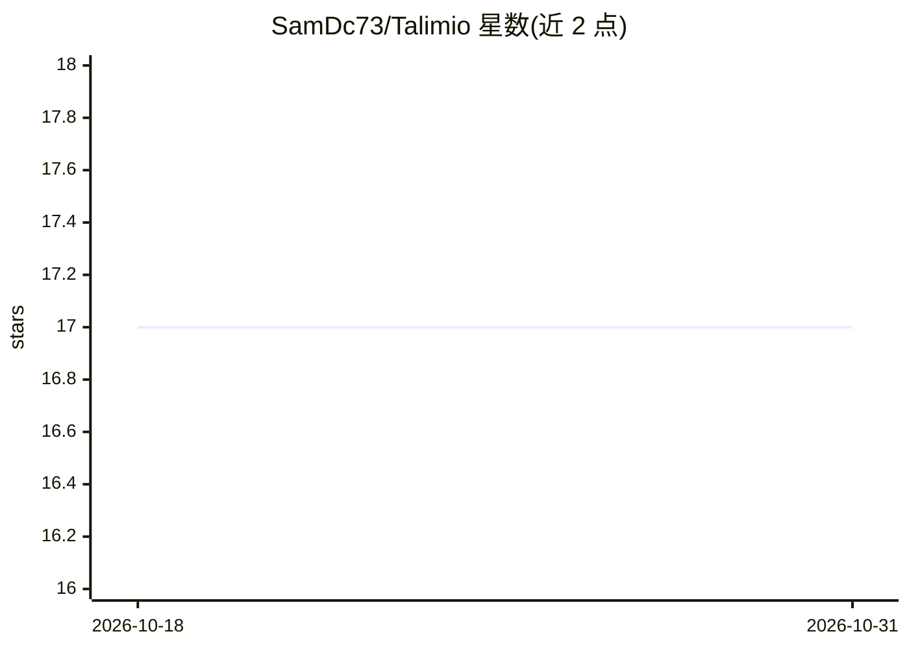

# SamDc73/Talimio

⭐ 17 · Python · AGPL-3.0 · 推送 2026-09-13 · [GitHub](https://github.com/SamDc73/Talimio) · [官网](https://talimio.com) · 个人维护

**自适应 AI 学习平台：把任意主题生成交互课程**

面向学习者的全栈学习平台：用户输入主题或上传文档/YouTube 链接，AI 生成完整课程；课程按 DAG 依赖图逐步解锁，LECTOR 调度器复现薄弱概念；课程内含可交互组件、可执行代码块与自测问答。支持上传 PDF 与 RAG、偏好持久记忆，并可通过 MCP 接入外部工具。运行时可通过 Ollama 全离线，或经 LiteLLM 使用云端 API key；提供 Docker Compose 部署与源码本地开发两条路径。

## 筛选速览

| 维度 | 判定 | 备注 |
|---|---|---|
| AI 角色 | `ai-native` | 本体是模型或模型工具 |
| 许可风险 | `viral` | AGPL-3.0 |
| 部署形态 | `self-host` | docker 或自建部署 |
| 模型依赖 | local-ok | 支持本地模型 |
| 硬件要求 | — | 无带数字的原话,不猜 |
| 安装摩擦 | `low` | 无编译、无系统依赖或容器化 |
| 成熟度 | — | 结构信号不足 |

## 能力要点

- 任意主题生成课程，支持文档 RAG 与 YouTube 链接对话
- DAG 依赖解锁 + LECTOR 调度的自适应课程结构
- 课程内交互组件与可执行代码块
- Ollama 100% 离线运行，或经 LiteLLM 接多家云端供应商
- MCP 扩展接入自有工具与 API

## 适用场景

- 把任意主题或 PDF 书快速变成系统课程自学
- 按依赖顺序循序渐进地掌握新领域知识
- 在离线环境中搭建私有 AI 学习平台

## 场景标签

`教程课程` · 领域:学习与行业

## 证据(README 行号)

> L9: - Turn any topic into a full course in seconds. Upload your own documents to ground the AI with RAG, or let the mode
> L10: - Create adaptive courses where the AI builds a dependency graph (DAG) and only unlocks new lessons once you’ve mas
> L16: - Run the whole stack 100% offline with Ollama, or plug in your own cloud API keys (supports many providers via Lit

## 星数曲线

2026-10-18 17 → 2026-10-31 17（+0）

---
*卡片 v1 · prompt 1.4 · 生成 2026-10-29 · 置信度 mid · 依据 README sha `d50389ad56ba` · [字段定义](../../DATASET.md)*
