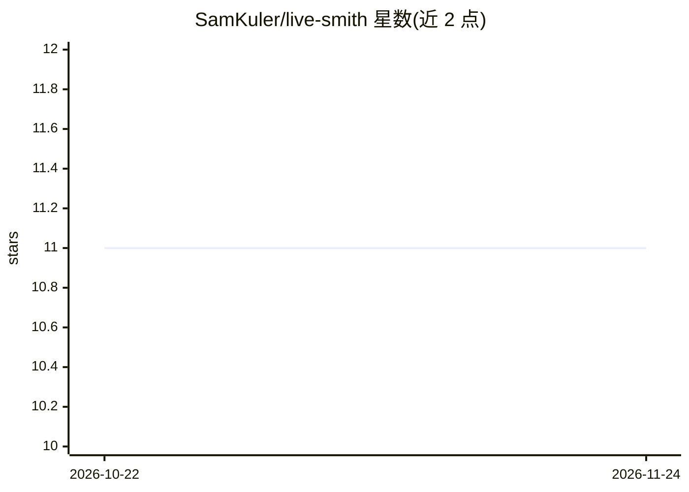

# SamKuler/live-smith

⭐ 11 · TypeScript · 推送 2026-11-09 · [GitHub](https://github.com/SamKuler/live-smith) · 个人维护 · 中文 README

**Ableton Live 内的对话式 AI 助手：编辑 MIDI、设备与音频**

以 Ableton Live 12 Suite Beta Extensions 形式安装的 AI 助手，通过对话检查轨道、Clip、设备与混音器状态，生成与变换 MIDI、整理轨道与 Scene、保存并比较设备参数快照，可选接入音频生成、音效与分轨服务。变更经 Edit Scope 与审批策略控制（Manual/Low Risk/Accept Everything），执行前验证计划并复核 Live 状态。支持 OpenAI/Anthropic API 或订阅账号登录连接模型，提供本机 MCP 服务供外部 AI 客户端使用，界面支持英文与简体中文。

## 筛选速览

| 维度 | 判定 | 备注 |
|---|---|---|
| AI 角色 | `ai-native` | 本体是模型或模型工具 |
| 许可风险 | `none` | — |
| 部署形态 | `None` |  |
| 模型依赖 | — | README 未给出锁定关系 |
| 硬件要求 | — | 无带数字的原话,不猜 |
| 安装摩擦 | `low` | 无编译、无系统依赖或容器化 |
| 成熟度 | `idea` | |

## 能力要点

- 对话式检查与编辑 Set：轨道、Clip、音符、设备与混音器
- Edit Scope 与三级审批策略控制 AI 可执行的编辑范围
- MIDI/音频结果与设备快照以 Artifacts 保存并可比较版本
- 提供本机 MCP 服务，外部 AI 客户端可经其操作 Live

## 适用场景

- 在 Live 里用对话生成和改写 MIDI 声部
- 保存、对比并回滚设备参数的不同版本
- 接入音频服务生成素材并预览导入 Live

## 场景标签

 · 领域:音乐制作/桌面工具

## 证据(README 行号)

> L5: Live Smith is an AI assistant inside Ableton Live. Start from a track, Clip or
> L19: - **Create and reshape MIDI.** Write parts, transform existing notes, arrange
> L47: 4. Open **Settings → Agent**, create a named Profile, and configure a model

## 星数曲线

2026-10-22 11 → 2026-11-24 11（+0）

---
*卡片 v1 · prompt 1.4 · 生成 2026-11-19 · 置信度 high · 依据 README sha `dbfe7517e6b9` · [字段定义](../../DATASET.md)*
