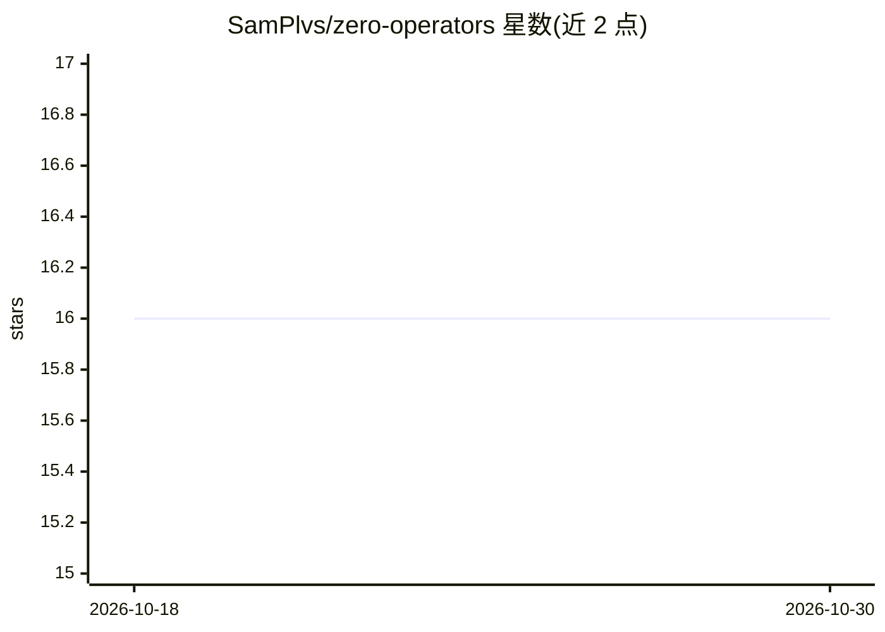

# SamPlvs/zero-operators

⭐ 16 · Python · MIT · 推送 2026-10-06 · [GitHub](https://github.com/SamPlvs/zero-operators) · [官网](https://zerooperators.com) · 个人维护

**自主 AI 研究工程团队：按计划派生 agent 完成训练到交付**

Zero Operators 是一个基于 Claude Code 的自主 AI 研究与工程团队编排工具：用户提供 GitHub 仓库、源文档与成功标准，ZO 起草 plan.md、在 tmux 中派生多角色 agent 团队，覆盖数据工程、建模、oracle 校验、代码评审、测试与可解释性，最终交付不含 ZO 痕迹的干净仓库。支持 supervised/auto/full-auto 三档人审门控、跨会话记忆与断点续跑，提供 draft/build/continue/report/preflight 等命令。默认档位一次参考运行约消耗 $10-15 API 费用，另设 --low-token 模式实测约省 30%。

## 筛选速览

| 维度 | 判定 | 备注 |
|---|---|---|
| AI 角色 | `ai-ecosystem` | LLM/agent 周边工具 |
| 许可风险 | `permissive` | MIT |
| 部署形态 | `None` |  |
| 模型依赖 | locked-api |  |
| 硬件要求 | — | 无带数字的原话,不猜 |
| 安装摩擦 | `low` | 无编译、无系统依赖或容器化 |
| 成熟度 | — | 结构信号不足 |

## 能力要点

- plan.md 驱动的多 agent 编排，覆盖完整 ML 生命周期
- supervised/auto/full-auto 三档阶段门控，可运行中切换
- 跨会话持久记忆与断点续跑，交付仓库零 ZO 痕迹
- --low-token 模式实测约 30% 节省，目标 70-80%

## 适用场景

- 让 AI agent 团队端到端完成数据工程到模型交付的 ML 项目
- 在阶段检查点上人工审阅指标与决策后放行
- 预算受限（Anthropic Pro/学生档）时用低 token 模式跑项目

## 场景标签

`多智能体` `编码 Agent` `MLOps` · 领域:Agent 开发

## 证据(README 行号)

> L12: Zero Operators (ZO) is an autonomous AI research and engineering team. You give it a project (a GitHub repo, some s
> L35: 3. **Launch**: `zo build plans/my-project.md` shows a phase review (subtasks, agents, oracle criteria), prompts for
> L168: During `zo build`, the main terminal shows a live activity feed: tasks, agent progress, comms events. Every 60 sec

## 星数曲线

2026-10-18 16 → 2026-10-30 16（+0）

---
*卡片 v1 · prompt 1.4 · 生成 2026-10-30 · 置信度 high · 依据 README sha `c48114d66148` · [字段定义](../../DATASET.md)*
