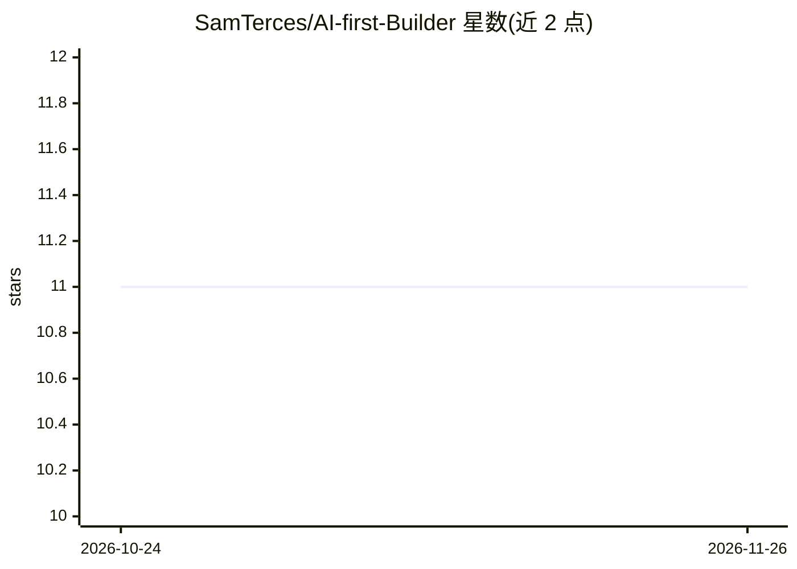

# SamTerces/AI-first-Builder

⭐ 11 · JavaScript · NOASSERTION · 推送 2026-07-23 · [GitHub](https://github.com/SamTerces/AI-first-Builder) · [官网](https://app-builder-pink.vercel.app) · 个人维护

**文本提示生成 React 网站的开源 AI 网站构建器**

基于 Next.js + Tailwind + Convex 的开源工具：用户输入自然语言提示，经 AI（原为 GPT-4o）生成多文件 React 组件项目，在 Sandpack 内嵌 IDE 中实时预览并导出完整工程。面向两类用户：非代码用户直接生成网站；开发者可 fork 作为构建自有 AI builder 的起点，文档给出更换 AI provider、修改生成提示、扩展功能的定制路径。注意：当前版本 AI 生成已禁用，API 路由返回 503，需从 git 历史恢复路由与配置并接入 provider key 才能启用。

## 筛选速览

| 维度 | 判定 | 备注 |
|---|---|---|
| AI 角色 | `ai-native` | 本体是模型或模型工具 |
| 许可风险 | `none` | NOASSERTION |
| 部署形态 | `library` | 以包/库形式分发 |
| 模型依赖 | — | README 未给出锁定关系 |
| 硬件要求 | — | 无带数字的原话,不猜 |
| 安装摩擦 | `low` | 无编译、无系统依赖或容器化 |
| 成熟度 | — | 结构信号不足 |

## 能力要点

- 自然语言提示生成多文件 React 项目并支持实时预览与导出
- 定位为可 fork 定制的 AI builder 起点，支持更换 AI provider（Anthropic/OpenAI/Gemini/Groq/Ollama 等）
- 生成提示可编辑以输出不同框架与样式（Vue/Svelte/CSS Modules 等）
- 当前版本 AI 生成处于禁用状态，路由返回 503，无需 API key

## 适用场景

- 用自然语言快速生成落地页、作品集等网站原型
- fork 后定制为自己的 AI 代码生成工具
- 通过编辑提示词让生成器输出团队规范的组件模式

## 场景标签

`代码生成` · 领域:编码与开发

## 证据(README 行号)

> L16: AI-First-Builder is an open-source tool that generates complete React websites from simple text prompts. Describe w
> L22: > **Note:** AI generation is currently disabled in this codebase — the AI API routes return `503` and no external A

## 星数曲线

2026-10-24 11 → 2026-11-26 11（+0）

---
*卡片 v1 · prompt 1.4 · 生成 2026-11-18 · 置信度 high · 依据 README sha `259598b15808` · [字段定义](../../DATASET.md)*
