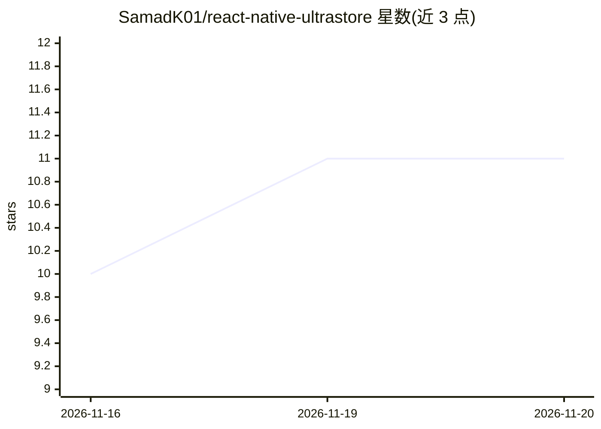

# SamadK01/react-native-ultrastore

⭐ 11 · TypeScript · MIT · 推送 2026-11-16 · [GitHub](https://github.com/SamadK01/react-native-ultrastore) · [官网](https://www.npmjs.com/package/react-native-ultrastore) · 个人维护

**为 React Native 提供基于 MMKV 的同步持久化状态与本地 AI 向量缓存**

构建在 MMKV v4 与 Nitro Modules 之上的 React Native 持久化存储与状态管理库：标量值走前缀快速路径避免 JSON 编解码，原生路径通过 JSI 同步读写，提供批量写入的 React 批处理通知、schema 迁移管理器、Zustand 持久化适配器与持久化查询 hook。AI 部分提供 Float32Array 直接评分的 VectorStore、流式输出缓存与上下文窗口辅助。明确声明不替代关系数据库或大规模 ANN 索引；不支持的本地环境回退 AsyncStorage 并需手动 hydrate。

## 筛选速览

| 维度 | 判定 | 备注 |
|---|---|---|
| AI 角色 | `ai-enhanced` | 去掉 AI 部分产品仍成立 |
| 许可风险 | `permissive` | MIT |
| 部署形态 | `library` | 以包/库形式分发 |
| 模型依赖 | — | README 未给出锁定关系 |
| 硬件要求 | — | 无带数字的原话,不猜 |
| 安装摩擦 | `low` | 无编译、无系统依赖或容器化 |
| 成熟度 | — | 结构信号不足 |

## 能力要点

- 标量 s:/n:/b: 前缀快速路径，原生路径同步读写无 Promise 包装
- setMany/batchSet 批量写入合并为单次 React 批处理通知
- VectorStore 直接读取 Float32Array 内存评分，持久化用 Base64
- 导出 /ai、/zustand、/query、/atom 等子路径模块

## 适用场景

- React Native New Architecture 应用中做同步持久化状态管理
- 端侧 RAG/语义搜索的向量缓存
- LLM 流式输出的本地累积缓存
- Zustand store 的持久化接入

## 场景标签

`向量数据库` · 领域:知识与检索

## 证据(README 行号)

> L3: Synchronous persisted state for React Native, built on MMKV v4 and Nitro Modules. UltraStore combines scalar fast pa
> L102: - `react-native-ultrastore/ai` — vectors, streaming cache, and context window helpers

## 星数曲线

2026-11-16 10 → 2026-11-20 11（+1）

---
*卡片 v1 · prompt 1.4 · 生成 2026-11-19 · 置信度 high · 依据 README sha `f91a2cffcc3c` · [字段定义](../../DATASET.md)*
