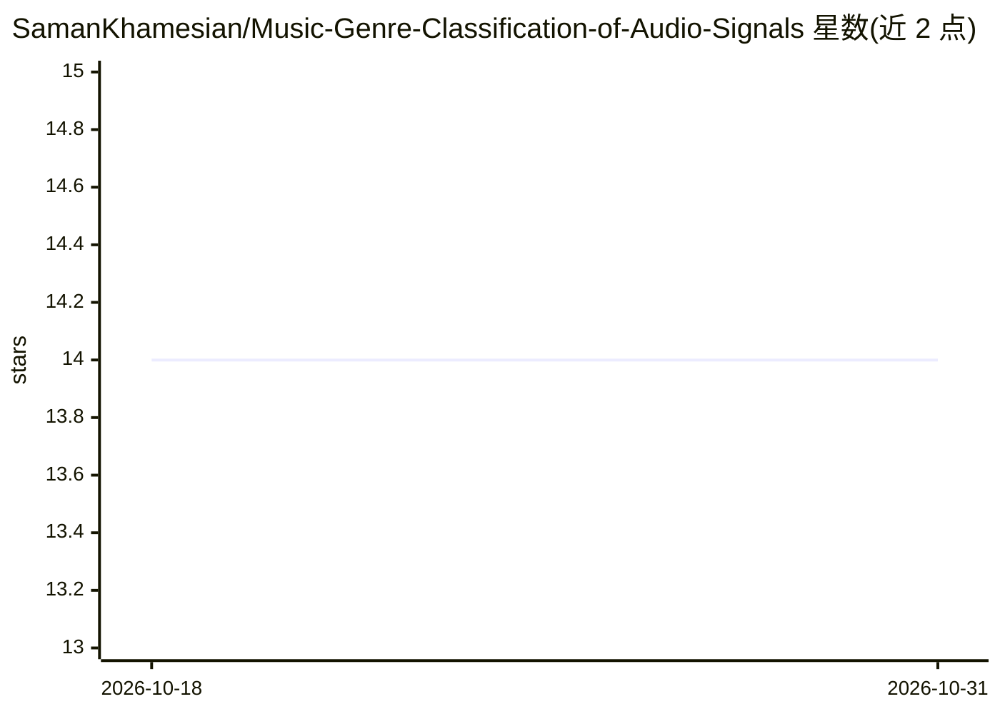

# SamanKhamesian/Music-Genre-Classification-of-Audio-Signals

⭐ 14 · Python · Apache-2.0 · 推送 2026-08-30 · [GitHub](https://github.com/SamanKhamesian/Music-Genre-Classification-of-Audio-Signals) · 个人维护

**用 librosa 特征与 SVM 做音频音乐流派分类的项目**

基于 Python 的音乐流派自动分类实现：用 librosa 读取音频，提取音色、节奏与和声特征（谱质心、MFCC、色度等，取均值与标准差），写入 CSV 后训练 SVM 分类器，代码中另留随机森林、MLP、kNN 备选模型；训练好的模型存盘后对测试文件夹中的音频预测流派。数据集使用 GTZAN Genre Collection（10 个流派），需自行下载并放到指定路径。适用于研究者与开发者复现论文方法或构建音乐信息检索的基线。

## 筛选速览

| 维度 | 判定 | 备注 |
|---|---|---|
| AI 角色 | `ai-native` | 本体是模型或模型工具 |
| 许可风险 | `permissive` | Apache-2.0 |
| 部署形态 | `library` | 以包/库形式分发 |
| 模型依赖 | — | README 未给出锁定关系 |
| 硬件要求 | — | 无带数字的原话,不猜 |
| 安装摩擦 | `low` | 无编译、无系统依赖或容器化 |
| 成熟度 | — | 结构信号不足 |

## 能力要点

- librosa 提取 timbral/rhythmic/harmonic 特征（MFCC、chroma、mel 等）
- SVM 为主分类器，随机森林/MLP/kNN 可切换
- 支持 GTZAN 数据集 10 个流派的训练与预测
- Main.py 顺序运行特征提取、训练、预测全流程

## 适用场景

- 对音乐文件自动标注流派类别
- 复现或研究基于机器学习的音频流派分类方法
- 作为音乐信息检索系统的流派分类组件

## 场景标签

 · 领域:音频/机器学习

## 证据(README 行号)

> L8: The pipeline turns every track into a compact numeric summary and then learns to separate the genres from it. Each f
> L6: This project is an implementation of music genre classification of audio signals based on machine learning technique

## 星数曲线

2026-10-18 14 → 2026-10-31 14（+0）

---
*卡片 v1 · prompt 1.4 · 生成 2026-10-31 · 置信度 high · 依据 README sha `36d22ea46d4a` · [字段定义](../../DATASET.md)*
