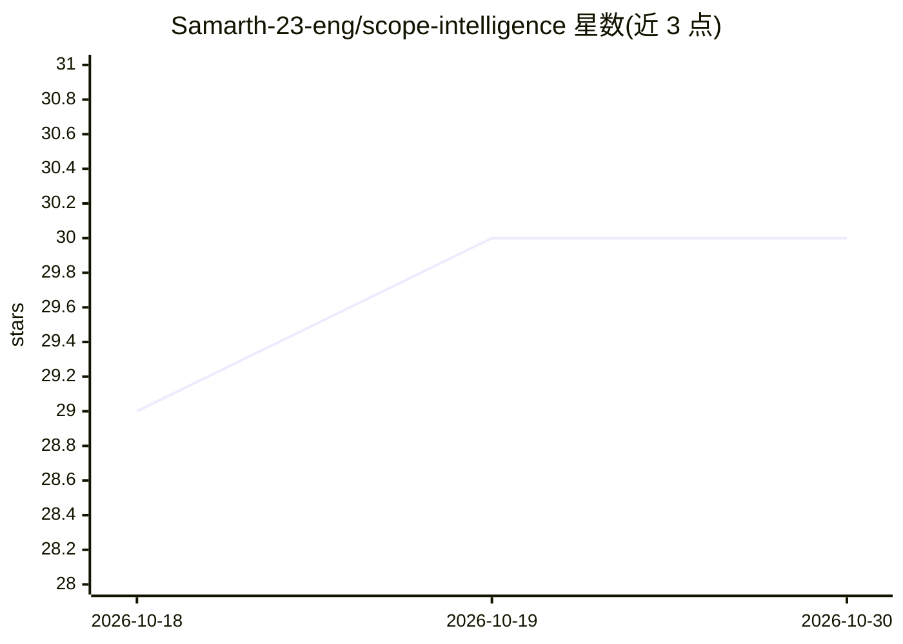

# Samarth-23-eng/scope-intelligence

⭐ 30 · Python · MIT · 推送 2026-10-24 · [GitHub](https://github.com/Samarth-23-eng/scope-intelligence) · 个人维护

**自托管 OSINT 工作台：把公开网络证据转为可溯源的公司情报**

自托管的开源情报研究平台（FastAPI + Next.js + Docker Compose），面向情报调查人员与合规研究人员：从公司名称出发做实体发现，经 HTTP/浏览器渲染、RSS、PDF、GitHub、YouTube 元数据等有界采集建立版本化证据库，支持词汇+向量混合检索、带引用的 AI 摘要、实体关系图谱、持续监控与验证队列。所有 agent 共享一个经加密 BYOK 网关连接的模型（OpenAI/Anthropic/Gemini/Ollama 等）。处于 pre-alpha，实验性 Social Collection Studio 与 Deep Research Lab（Tor GET-only）默认关闭。

## 筛选速览

| 维度 | 判定 | 备注 |
|---|---|---|
| AI 角色 | `ai-ecosystem` | LLM/agent 周边工具 |
| 许可风险 | `permissive` | MIT |
| 部署形态 | `self-host` | docker 或自建部署 |
| 模型依赖 | local-ok | 支持本地模型 |
| 硬件要求 | — | 无带数字的原话,不猜 |
| 安装摩擦 | `low` | 无编译、无系统依赖或容器化 |
| 成熟度 | `idea` | |

## 能力要点

- 版本化证据库：不可变文档版本、来源健康度、引用完整性
- 实体关系图谱：别名、时间观测、佐证/矛盾记录与图指标
- 统一模型网关（加密 BYOK），支持 OpenAI/OpenRouter/Anthropic/Gemini/Ollama/LM Studio
- 每公司监控调度、变更检测与 PDF 简报/邮件/Discord 告警

## 适用场景

- 调查一家公司：从名称出发聚合公开证据形成可审查的情报画像
- 持续监控目标公司的公开动态变更并接收告警
- 在本地隔离环境对公开来源做有证据引用的 AI 研究分析

## 场景标签

`网页抓取` `知识图谱` `科研工具` · 领域:效率与自动化

## 证据(README 行号)

> L13:  Scope Intelligence is a self-hosted OSINT research workspace for collection,
> L53: - agents share one operator-selected model through an encrypted BYOK gateway;
> L75: |Model gateway|OpenAI, OpenRouter, Anthropic, Gemini, Ollama, LM Studio, and custom OpenAI-compatible endpoints|

## 星数曲线

2026-10-18 29 → 2026-10-30 30（+1）

---
*卡片 v1 · prompt 1.4 · 生成 2026-10-26 · 置信度 mid · 依据 README sha `926dbe8b0871` · [字段定义](../../DATASET.md)*
