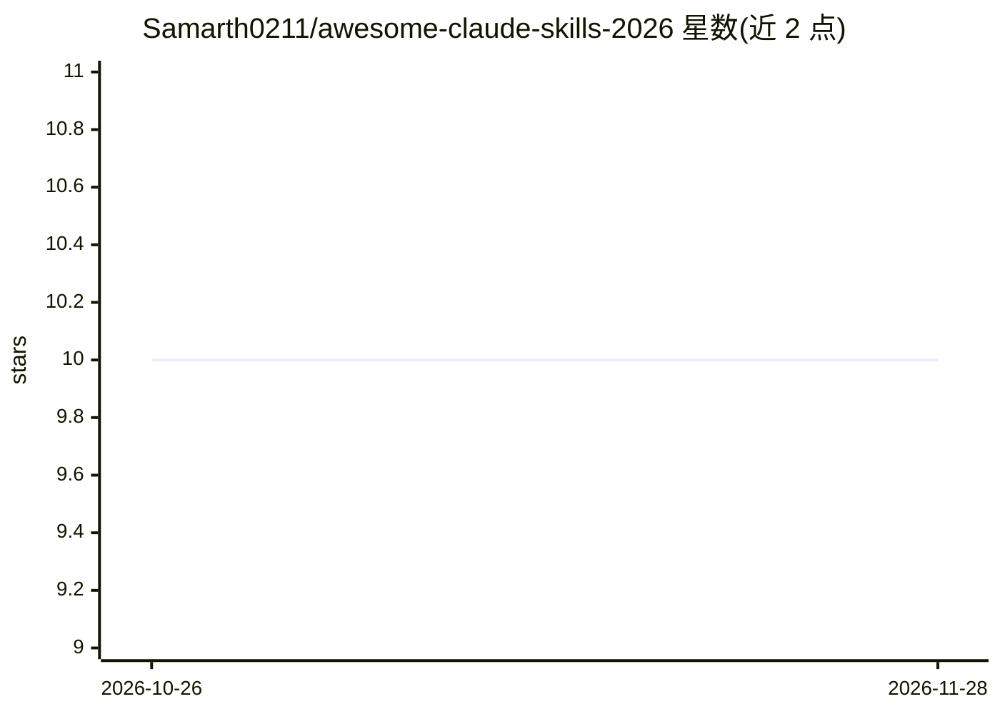

# Samarth0211/awesome-claude-skills-2026

⭐ 10 · 推送 2026-03-28 · [GitHub](https://github.com/Samarth0211/awesome-claude-skills-2026) · 个人维护

**面向开发者的 Claude Code 技能与 agent 策展清单（2300+）**

一份 2026 年度的 Claude Code 技能、agent 与提示词资源策展清单：收录官方 anthropics/skills 条目、10 个面向开发流程的自主 agent（PR 审查、测试生成、安全审计、数据库迁移等）、按 60+ 类别组织的技能集合分类，以及 100 条提示快捷指令；技能从配套站点 clskills.in 检索与下载，README 给出 curl 命令将技能文件放入 ~/.claude/skills 目录，另列出其他技能仓库链接。许可为 CC BY-NC-ND 4.0，仅限个人使用。

## 筛选速览

| 维度 | 判定 | 备注 |
|---|---|---|
| AI 角色 | `ai-knowledge` | 知识聚合/清单类 |
| 许可风险 | `none` | — |
| 部署形态 | `None` |  |
| 模型依赖 | — | README 未给出锁定关系 |
| 硬件要求 | — | 无带数字的原话,不猜 |
| 安装摩擦 | `low` | 无编译、无系统依赖或容器化 |
| 成熟度 | — | 结构信号不足 |

## 能力要点

- 收录 2,300+ 技能、10 个自主 agent 与 100 条提示快捷指令的目录
- 按前端、后端、DevOps、AI/ML、SAP、Salesforce 等 60+ 类别组织
- 配套站点 clskills.in 提供搜索、过滤与一键下载
- 给出 curl 命令直接下载技能文件到 ~/.claude/skills

## 适用场景

- 为 Claude Code 查找特定领域的现成技能
- 下载预构建的开发流程 agent（代码审查、测试、安全审计等）
- 浏览社区技能仓库生态并对比收录情况

## 场景标签

`精选清单` · 领域:学习与行业

## 证据(README 行号)

> L1: # Awesome Claude Skills 2026
> L4: A curated list of the best Claude Code skills, agents, and resources for 2026.
> L6: > **Browse and download all skills at clskills.in** — 2,300+ skills with search, filters, and one-click download.

## 星数曲线

2026-10-26 10 → 2026-11-28 10（+0）

---
*卡片 v1 · prompt 1.4 · 生成 2026-11-20 · 置信度 high · 依据 README sha `01fee57d98cc` · [字段定义](../../DATASET.md)*
