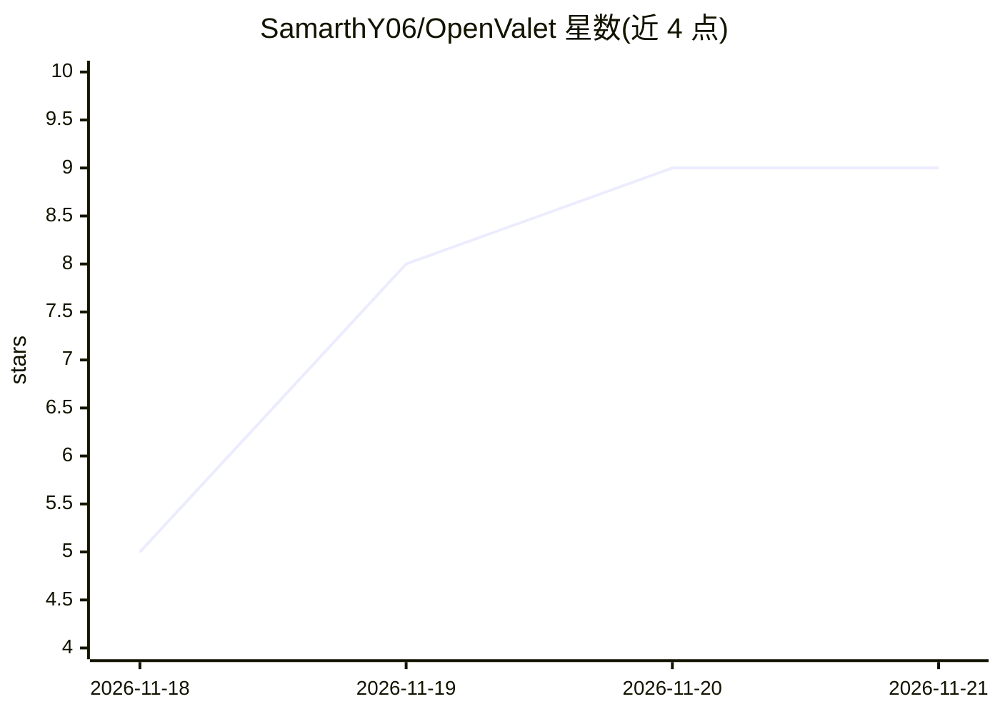

# SamarthY06/OpenValet

⭐ 9 · Python · MIT · 推送 2026-11-15 · [GitHub](https://github.com/SamarthY06/OpenValet) · 个人维护

**开源语音/WhatsApp 代理，用自己的 Claude 登录操控 Mac 应用**

运行在 Apple Silicon Mac 上的开源语音代理：本地唤醒词、语音识别、轮次检测与 TTS，大脑为通过 Claude Agent SDK 调用用户自己的 Claude Code 登录。可跨 Chrome、Mail、WhatsApp、Notes 等应用执行任务，不可逆操作（发送/删除/支付）由确定性规则门拦截，需用户口头确认。支持定时任务、屏幕查看、记忆文件 memory.md、语音克隆与 8 语言 54 种声音；当前仅支持 macOS 14+，数据留在本机。

## 筛选速览

| 维度 | 判定 | 备注 |
|---|---|---|
| AI 角色 | `ai-native` | 本体是模型或模型工具 |
| 许可风险 | `permissive` | MIT |
| 部署形态 | `None` |  |
| 模型依赖 | locked-api |  |
| 硬件要求 | — | 无带数字的原话,不猜 |
| 安装摩擦 | `low` | 无编译、无系统依赖或容器化 |
| 成熟度 | — | 结构信号不足 |

## 能力要点

- 本地唤醒词、语音识别、端点检测与 TTS，音频不出本机
- 跨应用任务执行：Chrome、Mail、WhatsApp、Notes、Calendar 等
- 确定性安全门：不可逆操作需口头 yes 确认，令牌绑定工具且模型不可见
- WhatsApp 群组接入、定时任务与持久记忆

## 适用场景

- 用语音让 Mac 代为查资料、写笔记、发邮件和 WhatsApp 消息
- 设定定时任务（如每天早晨自动筛选简历匹配的公司）
- WhatsApp 群里以消息驱动后台任务并收到汇报

## 场景标签

`语音 Agent` · 领域:对话与助手

## 证据(README 行号)

> L3: **Talk to your Mac. It does the work, in your apps, and asks before anything leaves the machine.**
> L7: Code agent loop through the Claude Agent SDK) with your own Claude login; the wake word, speech
> L8: recognition, end-of-turn detection and voice run locally on your Mac. It also answers in the

## 星数曲线

2026-11-18 5 → 2026-11-21 9（+4）

---
*卡片 v1 · prompt 1.4 · 生成 2026-11-20 · 置信度 high · 依据 README sha `c27f7b5370a6` · [字段定义](../../DATASET.md)*
