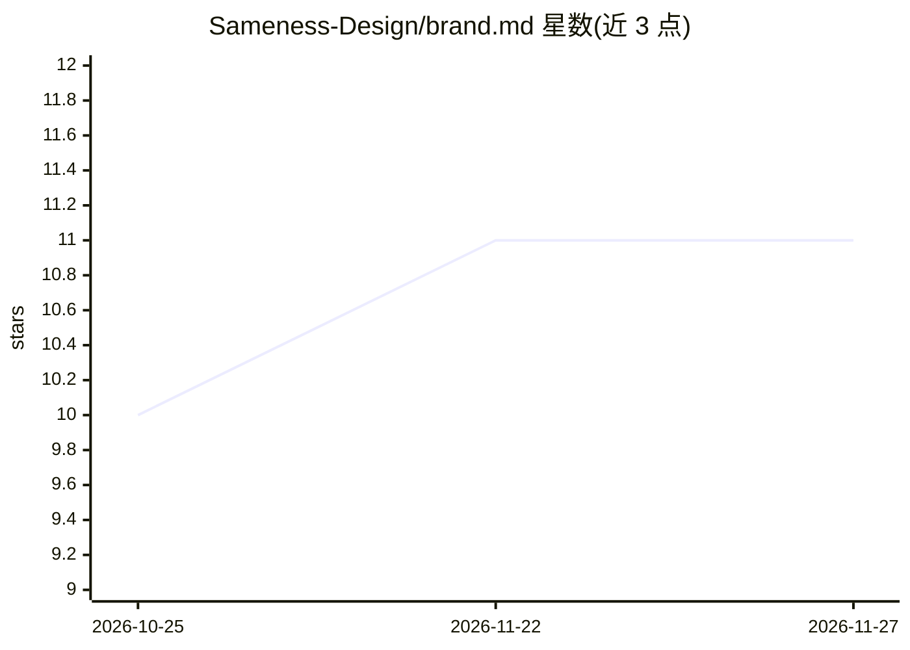

# Sameness-Design/brand.md

⭐ 11 · NOASSERTION · 推送 2026-08-30 · [GitHub](https://github.com/Sameness-Design/brand.md) · [官网](https://www.sameness.co) · 组织维护

**面向 AI 工具的可执行品牌身份开放标准文件规范**

brand.md 是一个结构化 Markdown 文件规范，放在项目根目录，向 AI 工具提供品牌上下文，供其在写作、设计、生成与开发时遵循品牌要求。核心机制是三层结构：精确层（可验证值）、语义层（供生成使用的含义）、关系层（配对/继承/误用规则）。仓库包含规范、语义层模型、与 llms.txt/design.md/CLAUDE.md 等文件的定位说明、虚构示例及官方注册模型；另说明由 Sameness 从结构化品牌图谱生成该文件。

## 筛选速览

| 维度 | 判定 | 备注 |
|---|---|---|
| AI 角色 | `ai-enhanced` | 去掉 AI 部分产品仍成立 |
| 许可风险 | `none` | NOASSERTION |
| 部署形态 | `None` |  |
| 模型依赖 | — | README 未给出锁定关系 |
| 硬件要求 | — | 无带数字的原话,不猜 |
| 安装摩擦 | `low` | 无编译、无系统依赖或容器化 |
| 成熟度 | — | 结构信号不足 |

## 能力要点

- 三层结构：精确值、语义含义、关系治理规则
- 与 llms.txt、design.md、CLAUDE.md 等文件的分层定位说明
- 包含规范、虚构示例与官方 brand 文件注册模型

## 适用场景

- 让 AI 写作/设计工具在生成内容时遵循品牌规范
- 为品牌项目提供 AI 可读的品牌上下文文件
- 治理 AI 生成中的品牌漂移问题

## 场景标签

 · 领域:设计/品牌与 AI 工具上下文

## 证据(README 行号)

> L3: An open standard for AI-executable brand identity.
> L7: Most brand guidelines describe a brand for humans. `brand.md` is built for AI systems that need to act on brand guid

## 星数曲线

2026-10-25 10 → 2026-11-27 11（+1）

---
*卡片 v1 · prompt 1.4 · 生成 2026-11-20 · 置信度 high · 依据 README sha `dc6880de0c4f` · [字段定义](../../DATASET.md)*
