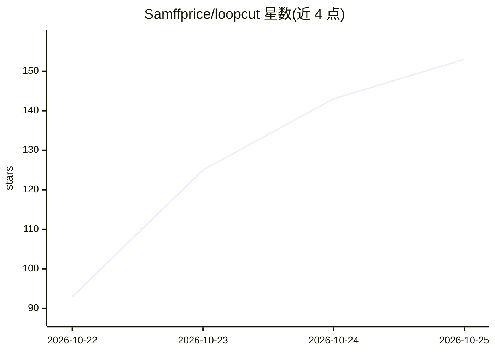

# Samffprice/loopcut

⭐ 159 · C++ · GPL-3.0 · 推送 2026-10-25 · [GitHub](https://github.com/Samffprice/loopcut) · [官网](https://loopcut.org) · 组织维护

**内置 AI agent 的 Blender 5.2 分支，一句话完成技术性操作**

Loopcut 是 Blender 5.2.2 的 GPL 分支，在其中加入一个 AI agent 面板：用户用一句话描述技术性工作（重命名、修法线、排修改器、搭灯组、批量导出等），agent 编写并运行 Python，每步代码经用户批准后执行，从场景实测变更生成 diff 卡片，并通过截取视口自查与参照图比对。支持自带 Anthropic 或任意 OpenAI 兼容提供商的 key、本地 GPU 运行（Ollama/vLLM 等）或官方托管模型。每轮场景变更为检查点，可一键回退。macOS/Windows 提供安装包，构建未签名需手动放行。

## 筛选速览

| 维度 | 判定 | 备注 |
|---|---|---|
| AI 角色 | `ai-enhanced` | 去掉 AI 部分产品仍成立 |
| 许可风险 | `viral` | GPL-3.0 |
| 部署形态 | `desktop` | 安装包/桌面程序 |
| 模型依赖 | local-ok | 支持本地模型 |
| 硬件要求 | — | 无带数字的原话,不猜 |
| 安装摩擦 | `medium` | 含编译或系统依赖之一 |
| 成熟度 | — | 结构信号不足 |

## 能力要点

- agent 编写运行 Python，每步经批准后执行并输出实测场景 diff
- capture_viewport 截取视口自查，可对照参考图比对调整
- 每轮变更形成检查点，一键恢复场景与对话
- 支持自带 key（Anthropic/OpenAI 兼容）、本地模型（Ollama/vLLM 等）或托管服务

## 适用场景

- 用一句话让 agent 完成重命名、修法线、排修改器等技术操作
- 搭灯组、设渲染预设并对照参考照片调整构图
- 在本地 GPU 上离线运行模型，不让场景数据离开本机

## 场景标签

`GUI 自动化` · 领域:效率与自动化

## 证据(README 行号)

> L9:  An open-source AI agent inside Blender. Describe the technical work in a sentence; Loopcut writes and runs the Pyth
> L35: - **It's Blender.** Loopcut is Blender 5.2 with a panel and about forty changed files. Import your settings, add-on

## 星数曲线

2026-10-22 93 → 2026-10-25 153（+60）

---
*卡片 v1 · prompt 1.4 · 生成 2026-10-23 · 置信度 high · 依据 README sha `41ad6144e2d2` · [字段定义](../../DATASET.md)*
