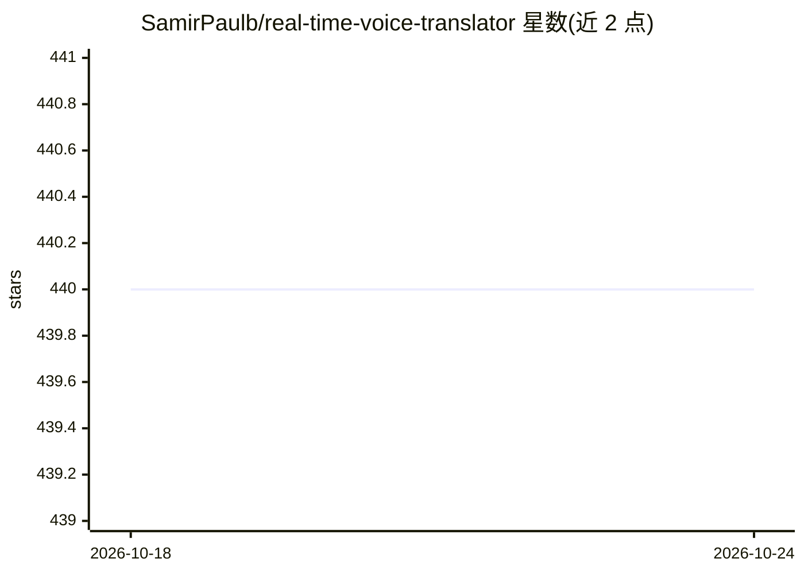

# SamirPaulb/real-time-voice-translator

⭐ 440 · Tcl · GPL-2.0 · 推送 2026-05-04 · [GitHub](https://github.com/SamirPaulb/real-time-voice-translator) · [官网](https://samirpaulb.github.io/posts/real-time-voice-translator) · 个人维护

**实时语音翻译桌面应用：跨语言保留语气与情感**

基于机器学习的桌面应用 LinguaSync，通过深度神经网络将语音在语言间实时翻译，并保留说话者语气与情感。用户选择源语言与目标语言后开始说话，应用监听语音并即时输出翻译，也可用于两人以上的对话翻译。支持 Windows/Linux/macOS，依赖 gTTS、pyaudio、deep-translator、SpeechRecognition 等库，通过克隆源码、虚拟环境和 pip 安装依赖运行 main.py，另可用 cx_Freeze 打包各平台安装包。

## 筛选速览

| 维度 | 判定 | 备注 |
|---|---|---|
| AI 角色 | `ai-native` | 本体是模型或模型工具 |
| 许可风险 | `viral` | GPL-2.0 |
| 部署形态 | `library` | 以包/库形式分发 |
| 模型依赖 | — | README 未给出锁定关系 |
| 硬件要求 | — | 无带数字的原话,不猜 |
| 安装摩擦 | `low` | 无编译、无系统依赖或容器化 |
| 成熟度 | — | 结构信号不足 |

## 能力要点

- 语音到语音的实时跨语言翻译，保留语气与情感
- 支持双人及以上对话翻译场景
- 用 cx_Freeze 构建 Windows/Linux/Mac 可执行安装包

## 适用场景

- 与外语使用者进行实时对话翻译
- 跨语言沟通时保留自己的语气与情感
- 作为机器学习课程/毕业设计项目学习语音翻译流程

## 场景标签

`语音识别` `语音合成` · 领域:内容生成

## 证据(README 行号)

> L3: Real-Time Voice Translator is a machine learning project that aims to provide a seamless and natural experience of c
> L5: The application is easy to use: simply select the languages you want to translate between and start speaking. The ap

## 星数曲线

2026-10-18 440 → 2026-10-24 440（+0）

---
*卡片 v1 · prompt 1.4 · 生成 2026-10-21 · 置信度 high · 依据 README sha `004b1ddca0ec` · [字段定义](../../DATASET.md)*
