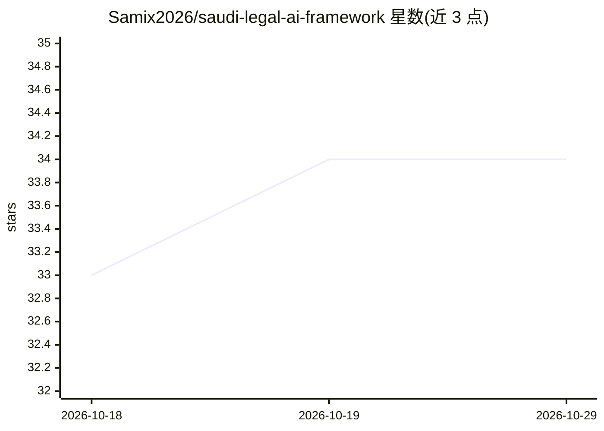

# Samix2026/saudi-legal-ai-framework

⭐ 34 · HTML · 推送 2026-08-03 · [GitHub](https://github.com/Samix2026/saudi-legal-ai-framework) · 个人维护

**沙特法律 AI 上下文框架：技能文件与数据集供 LLM 引用沙特法规**

面向沙特阿拉伯法律环境的开源资源集合：提供 9 个 AI 技能文件（skills/）、20 个官方法规摘要（sources/）、11 组结构化数据集、14 个示例与提示模板，用户将技能文件粘贴进 Claude/ChatGPT/Gemini 等对话即可让回答引用具体皇家法令与条款。另含 Docker 构建的 MCP 服务器（合同条款风险分析、法规摘要、合同风险检索 3 个工具）与内部评测系统（5 个 draft 状态用例）。声明仅供初步研究，非法律咨询，内容待持牌律师审核。

## 筛选速览

| 维度 | 判定 | 备注 |
|---|---|---|
| AI 角色 | `ai-knowledge` | 知识聚合/清单类 |
| 许可风险 | `permissive` | — |
| 部署形态 | `library` | 以包/库形式分发 |
| 模型依赖 | — | README 未给出锁定关系 |
| 硬件要求 | — | 无带数字的原话,不猜 |
| 安装摩擦 | `low` | 无编译、无系统依赖或容器化 |
| 成熟度 | `idea` | |

## 能力要点

- 9 个法律技能文件 + 20 个官方法规摘要 + 11 组数据集
- Docker 版 MCP 服务器提供 3 个法律分析工具
- 评测系统以官方来源衡量检索与推理质量（用例均为 draft）
- 支持任意遵循指令的 LLM（粘贴即用）

## 适用场景

- 让 Claude/ChatGPT 回答沙特法律问题时引用具体法令条款
- 通过 MCP 工具做合同条款风险分析
- 查沙特官方法规的结构化摘要与数据集

## 场景标签

`提示工程` · 领域:Agent 开发

## 证据(README 行号)

> L7: مجموعة مفتوحة المصدر من المهارات والمصادر القانونية تمنح الذكاء الاصطناعي السياق الصحيح للتعامل مع القانون السعودي.
> L9: Open-source collection of legal skills, source references, and datasets that give AI assistants the context they nee
> L77: |`skills/`|ملفات مهارة قانونية موجهة للذكاء الاصطناعي|9|

## 星数曲线

2026-10-18 33 → 2026-10-29 34（+1）

---
*卡片 v1 · prompt 1.4 · 生成 2026-10-25 · 置信度 mid · 依据 README sha `4e4f24a89589` · [字段定义](../../DATASET.md)*
