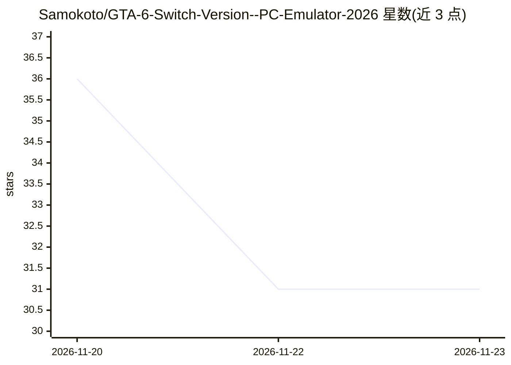

# Samokoto/GTA-6-Switch-Version--PC-Emulator-2026

⭐ 31 · Rust · Apache-2.0 · 推送 2026-11-21 · [GitHub](https://github.com/Samokoto/GTA-6-Switch-Version--PC-Emulator-2026) · 个人维护

**面向 Windows 玩家的 GTA VI PC 版安装准备与优化指南站点**

一个面向 Windows 10/11 用户的 GTA VI PC 版安装与配置资料页：覆盖 Windows 环境准备、显卡驱动更新、存储检查、Rockstar Games Launcher 设置、图形与 FPS 优化思路、常见安装错误排查等。README 声明其安装包仅为独立的 Windows 设置配套工具，不含 GTA VI 游戏文件；官方 PC 版发布日期与硬件要求尚未公布，页面以占位表格与链接形式组织内容，末尾附 SEO 关键词列表。

## 筛选速览

| 维度 | 判定 | 备注 |
|---|---|---|
| AI 角色 | `ai-enhanced` | 去掉 AI 部分产品仍成立 |
| 许可风险 | `permissive` | Apache-2.0 |
| 部署形态 | `desktop` | 安装包/桌面程序 |
| 模型依赖 | — | README 未给出锁定关系 |
| 硬件要求 | — | 无带数字的原话,不猜 |
| 安装摩擦 | `low` | 无编译、无系统依赖或容器化 |
| 成熟度 | — | 结构信号不足 |

## 能力要点

- Windows 兼容性准备清单（系统版本、DirectX、驱动、存储检查）
- 图形设置与 FPS/帧时间优化排查条目
- Rockstar Games Launcher 安装准备与官方资源链接
- 系统需求以'未确认'占位表格呈现

## 适用场景

- 为未来 GTA VI PC 版提前准备 Windows 环境与驱动
- 排查 PC 游戏常见的安装与显示错误
- 了解通用的 PC 游戏图形与 FPS 优化设置项

## 场景标签

 · 领域:游戏/PC 工具与指南

## 证据(README 行号)

> L5: A dedicated PC installation and configuration resource for Grand Theft Auto VI, covering Windows preparation, graphi
> L49: The companion installer does not contain or install GTA VI game files.
> L238: No. The project installer is intended for a separate Windows setup companion. GTA VI must be acquired through an a

## 星数曲线

2026-11-20 36 → 2026-11-23 31（-5）

---
*卡片 v1 · prompt 1.4 · 生成 2026-11-22 · 置信度 low · 依据 README sha `2fe487426686` · [字段定义](../../DATASET.md)*
