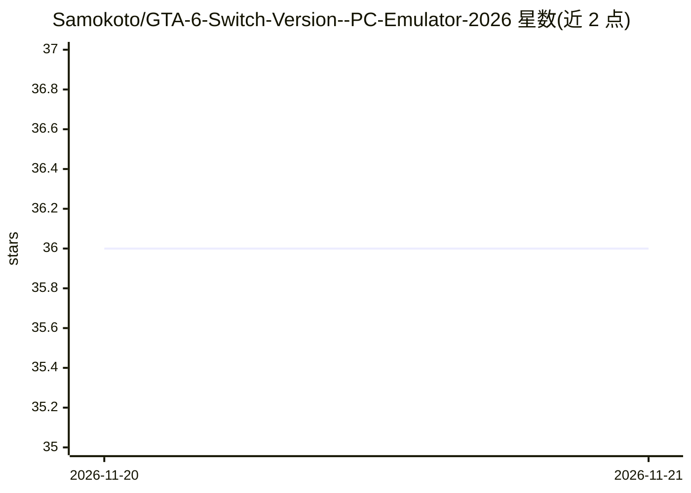

# Samokoto/GTA-6-Switch-Version--PC-Emulator-2026

⭐ 36 · Rust · Apache-2.0 · 推送 2026-11-19 · [GitHub](https://github.com/Samokoto/GTA-6-Switch-Version--PC-Emulator-2026) · 个人维护

**面向 Windows 用户的 GTA VI PC 版安装准备与配置指南站点**

一个围绕尚未发售的 GTA VI PC 版的 Windows 安装与配置资源，内容覆盖 Windows 准备、显卡驱动更新、存储检查、Rockstar Games Launcher 准备、图形画质选项说明、FPS 排障与常见安装错误类别。README 明确声明其安装包是独立的 Windows 设置配套工具，不含也不安装 GTA VI 游戏文件；官方配置要求尚未公布，表格各项均标注 Not confirmed。提供 .exe 安装包下载，无编译步骤。

## 筛选速览

| 维度 | 判定 | 备注 |
|---|---|---|
| AI 角色 | `ai-knowledge` | 知识聚合/清单类 |
| 许可风险 | `permissive` | Apache-2.0 |
| 部署形态 | `desktop` | 安装包/桌面程序 |
| 模型依赖 | — | README 未给出锁定关系 |
| 硬件要求 | — | 无带数字的原话,不猜 |
| 安装摩擦 | `low` | 无编译、无系统依赖或容器化 |
| 成熟度 | — | 结构信号不足 |

## 能力要点

- Windows 兼容性检查清单（系统版本/DirectX/驱动/存储）
- 安装排障分类与 FPS/卡顿/显示问题排查条目
- 官方系统需求表当前全部标注未确认
- README 声明安装器不包含游戏文件

## 适用场景

- 为将来 GTA VI PC 版发售提前检查和准备 Windows 环境
- 更新 NVIDIA/AMD/Intel 显卡驱动并检查 SSD 存储
- 参考 PC 游戏通用画质与帧率排障方法

## 场景标签

 · 领域:游戏/桌面工具

## 证据(README 行号)

> L5: A dedicated PC installation and configuration resource for Grand Theft Auto VI, covering Windows preparation, graphi
> L17: This repository is dedicated to Windows users preparing for the future PC edition of GTA VI.
> L30: The GTA VI PC release date and official hardware requirements have not yet been announced.

## 星数曲线

2026-11-20 36 → 2026-11-21 36（+0）

---
*卡片 v1 · prompt 1.4 · 生成 2026-11-20 · 置信度 mid · 依据 README sha `6954d37a13d3` · [字段定义](../../DATASET.md)*
