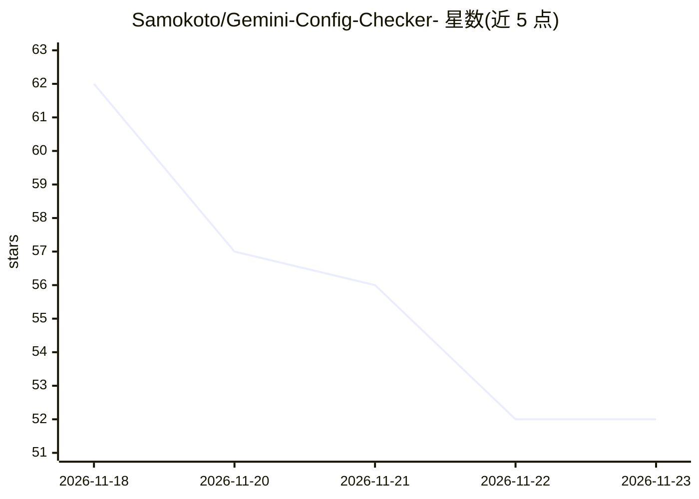

# Samokoto/Gemini-Config-Checker-

⭐ 52 · Go · Apache-2.0 · 推送 2026-11-21 · [GitHub](https://github.com/Samokoto/Gemini-Config-Checker-) · 个人维护

**给代理用户筛选能访问 Google AI Studio 与 Gemini 的配置**

桌面/Web/Android 应用，逐条测试代理配置是否能实际进入 Google AI Studio 与 Gemini。支持 Simple（测自有配置）与 Advanced（基础配置后串联免费配置）两种模式；核心机制是登录浏览器内核读取 Google 对已登录账号显示的区域判定，而非仅做连通性探测；内置可编辑的反 DPI profile（Finalmask fragment、fingerprint、ALPN、cipher）。提供链接/base64/Xray 配置导出，发布带 SHA256 校验。v0.1.0 早期预发布，仅 Windows 经过实际运行验证。

## 筛选速览

| 维度 | 判定 | 备注 |
|---|---|---|
| AI 角色 | `ai-ecosystem` | LLM/agent 周边工具 |
| 许可风险 | `permissive` | Apache-2.0 |
| 部署形态 | `desktop` | 安装包/桌面程序 |
| 模型依赖 | — | README 未给出锁定关系 |
| 硬件要求 | — | 无带数字的原话,不猜 |
| 安装摩擦 | `medium` | 含编译或系统依赖之一 |
| 成熟度 | `idea` | |

## 能力要点

- 以登录浏览器读取 Google 区域判定（20–40 秒/配置），避免 HTTP 探测误报
- Simple/Advanced 双模式，Advanced 支持免费配置链式串接
- 可编辑反 DPI profile（Finalmask fragment 等），本地 fragmenting forwarder
- 导出链接、base64 或完整 Xray 配置

## 适用场景

- 检测手里一堆代理配置哪些能进 AI Studio 和 Gemini
- Cloudflare 配置能连通但出口被 Google 拦时，串联免费配置换出口
- 在过滤网络环境下用反 DPI 设置建立连接

## 场景标签

`浏览器自动化` · 领域:效率与自动化

## 证据(README 行号)

> L11: Find proxy configs that actually get you into **Google AI Studio and Gemini**, by testing each one the way a person
> L50: Google decides region availability **per signed-in account, after the page has loaded**. A plain HTTP request (even
> L43: |XTLS/Xray-core|The proxy engine embedded in the app|

## 星数曲线

2026-11-18 62 → 2026-11-23 52（-10）

---
*卡片 v1 · prompt 1.4 · 生成 2026-11-20 · 置信度 high · 依据 README sha `629621f6930a` · [字段定义](../../DATASET.md)*
