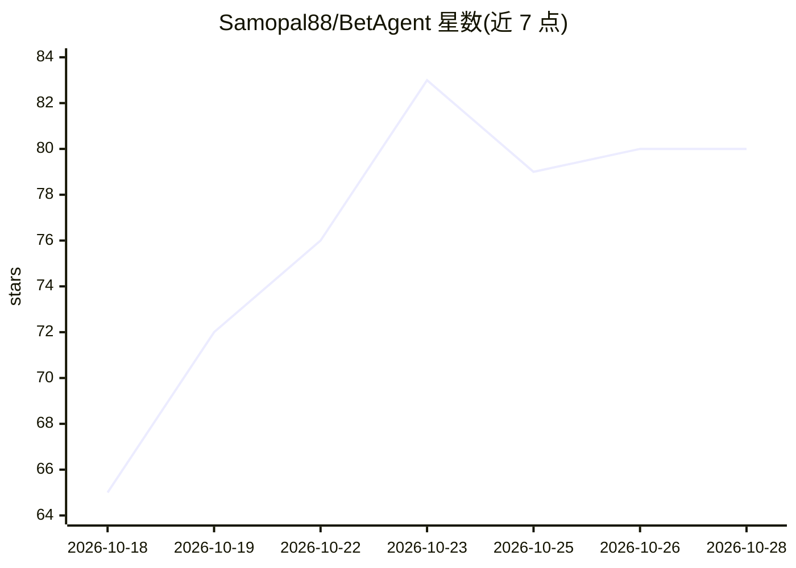

# Samopal88/BetAgent

⭐ 80 · Python · 推送 2026-09-21 · [GitHub](https://github.com/Samopal88/BetAgent) · 个人维护

**体育赛事算法分析平台：采集赔率与赛果，生成投注分析信号**

面向体育博彩研究场景的自动化分析平台（Python 3.10+，FastAPI）：从多来源采集赔率与赛果，用统计数据丰富比赛信息，应用规则策略与 ML 模型生成分析信号，支持 EV/Kelly 计算、回测、CLV 与策略影子对比，结果通过管理面板、HTTP API 和多个 Telegram 机器人交付。SQLite 存分析核心，PostgreSQL 存用户/订阅/账单（含 YooKassa 支付）。README 声明为工作原型，生产部署需自备密钥、PostgreSQL 及数据源验证；无明确开源许可证。

## 筛选速览

| 维度 | 判定 | 备注 |
|---|---|---|
| AI 角色 | `ai-native` | 本体是模型或模型工具 |
| 许可风险 | `none` | — |
| 部署形态 | `desktop` | 安装包/桌面程序 |
| 模型依赖 | — | README 未给出锁定关系 |
| 硬件要求 | — | 无带数字的原话,不猜 |
| 安装摩擦 | `low` | 无编译、无系统依赖或容器化 |
| 成熟度 | `idea` | |

## 能力要点

- 多来源赔率与赛果采集，覆盖足球/冰球/网球
- rule-based 与 ML 策略，含 EV、Kelly 与敞口限制计算
- 回测、CLV 与策略影子对比
- FastAPI 管理面板 + 多个 Telegram 机器人（管理员/客户端/公开频道）

## 适用场景

- 跑通体育赔率数据采集到信号生成的完整流水线
- 用回测和 CLV 检验自己的投注策略
- 通过 Telegram 接收分析信号通知

## 场景标签

`金融量化` · 领域:学习与行业

## 证据(README 行号)

> L6: BetAgent — платформа алгоритмической аналитики спортивных событий. Она собирает линии и результаты, обогащает матчи 
> L14: - rule-based и ML-стратегии;

## 星数曲线

2026-10-18 65 → 2026-10-28 80（+15）

---
*卡片 v1 · prompt 1.4 · 生成 2026-10-24 · 置信度 high · 依据 README sha `f38ff445a70d` · [字段定义](../../DATASET.md)*
